# TermoPie · Portal de termografía plantar


Portal médico–paciente para la **estimación del riesgo de úlcera de pie diabético a partir de termografía plantar**. Es la plataforma web del Proyecto Integrador de Ingeniería Biomédica (FCEFyN – Universidad Nacional de Córdoba):

> **«Procesamiento de imágenes y análisis punto a punto de termogramas plantares para la detección temprana del riesgo de pie diabético»**
> Alumna: María Inés Greising Revol · Asesor: Conrado J. Rodríguez · Co-asesoras: Dra. María Ranz y Álvarez, Dra. María Eugenia Lozano y Dra. Beatriz Alejandra García.
>
> Antecedente (Parte 1): «Correlación entre la termografía y la predicción de úlceras en pie diabético», Ana Paula Muñoz (FCEFyN – UNC).

> [!WARNING]
> **Herramienta exploratoria complementaria, no diagnóstica.** El portal está completo salvo el procesamiento de imágenes: el análisis actual es **simulado** (`mock-v0`) y determinístico. El algoritmo real se conecta reemplazando una única estrategia (ver [docs/despliegue.md](docs/despliegue.md#conectar-el-algoritmo-real)).

## Capturas

| Ingreso | Tablero del médico |
| --- | --- |
| 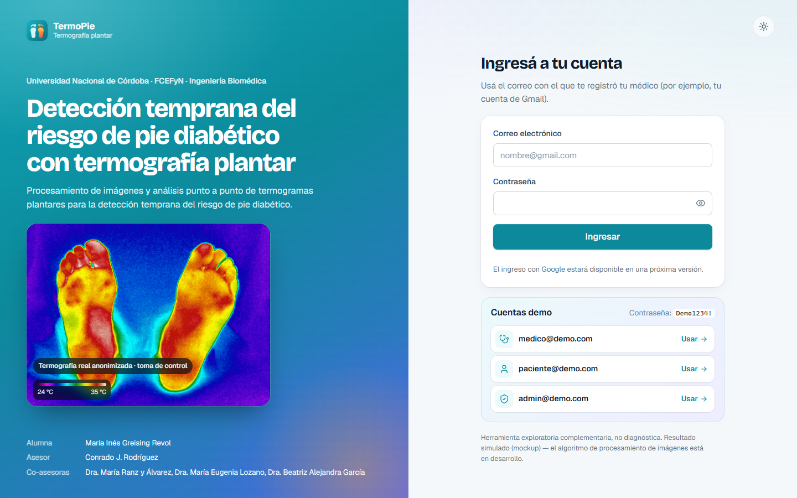 | 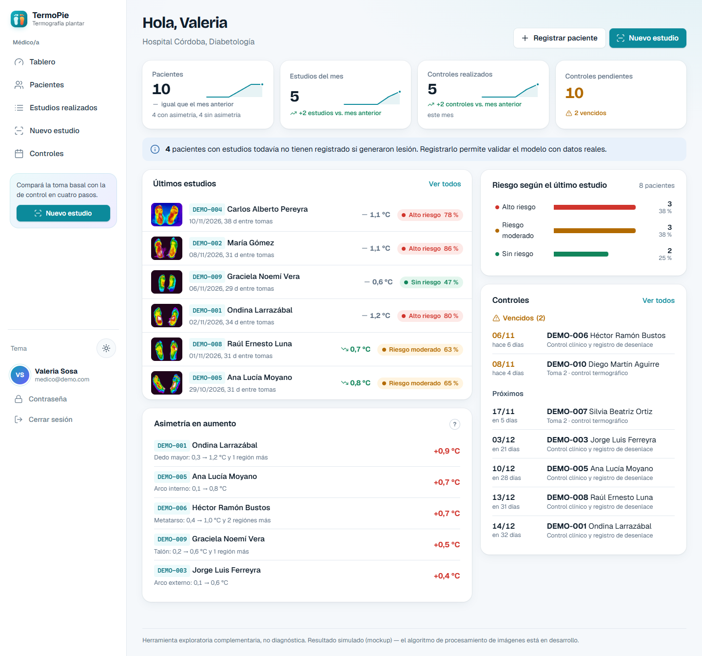 |
| **Resultado comparativo (toma 1 vs toma 2)** | **Evolución entre tomas (sin doble eje)** |
| 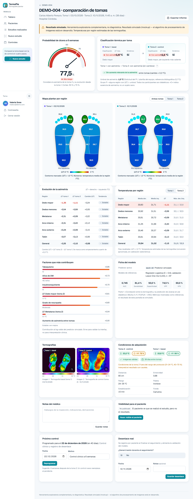 | 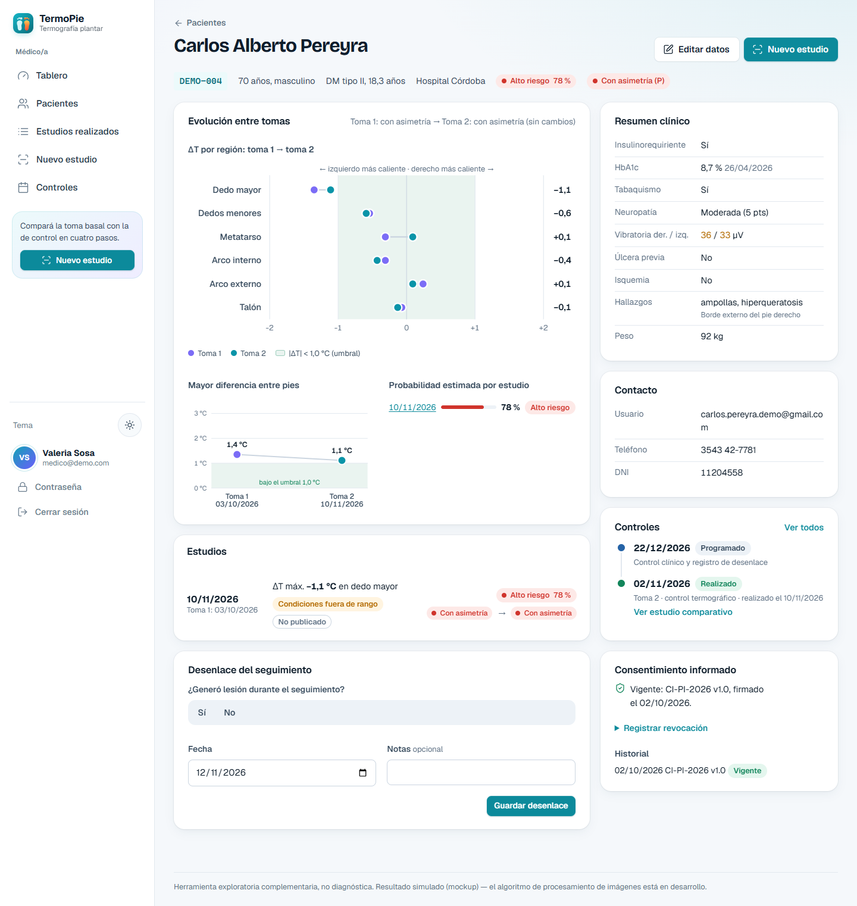 |
| **Estudios realizados** | **Controles** |
| 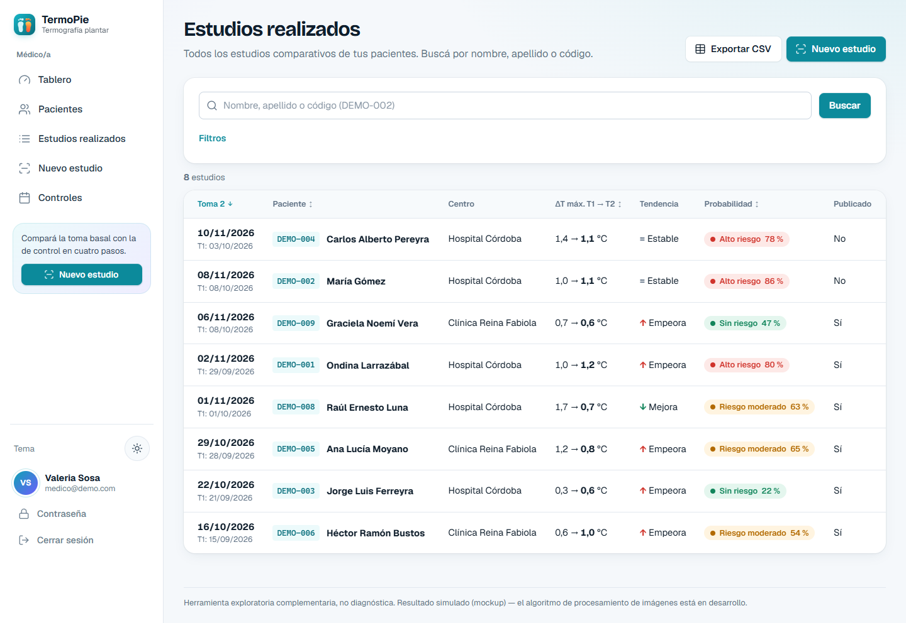 | 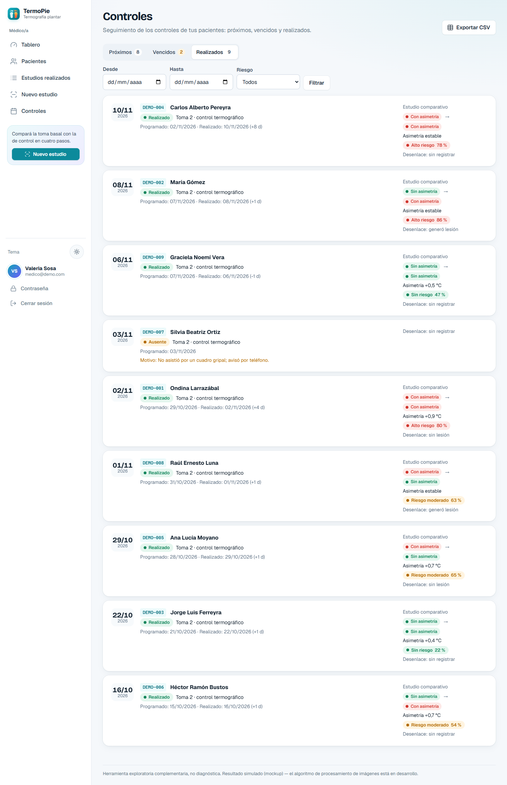 |
| **«Tu informe» (paciente)** | **Visor con paleta Fluke High Contrast** |
| 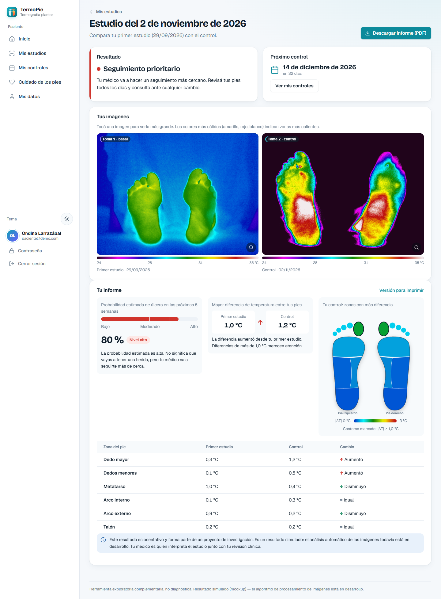 | 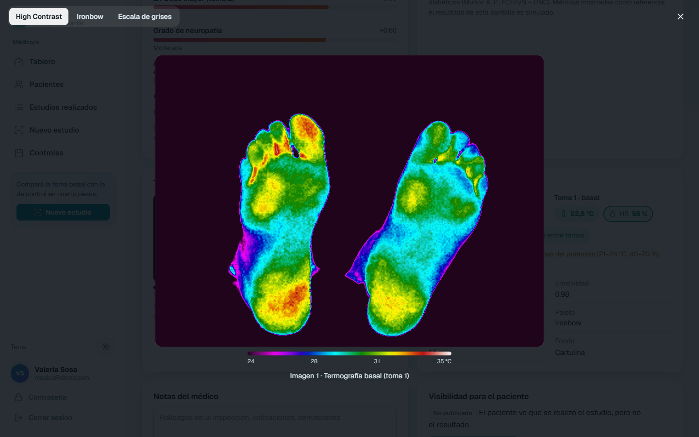 |
| **Asistente con vistas previas (PNG e IS2)** | **Tema oscuro (opcional)** |
| 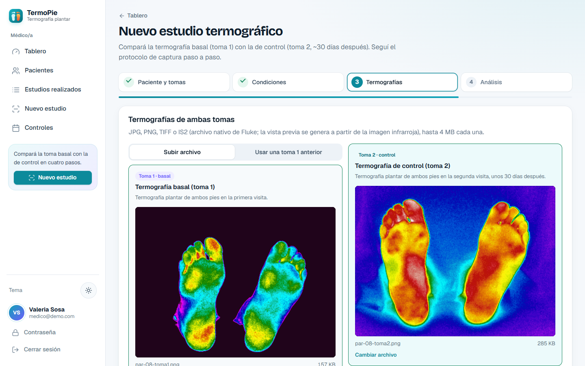 | 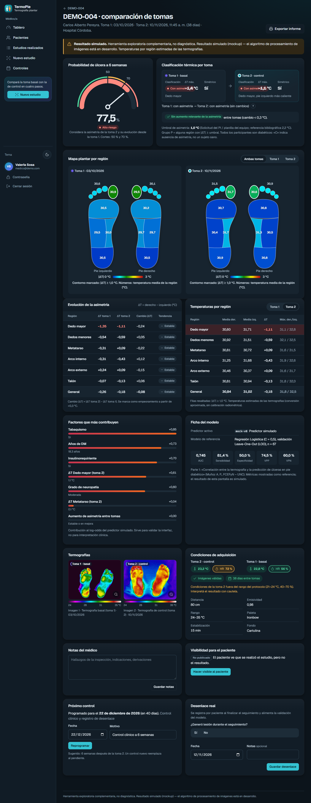 |

Paletas disponibles en el visor (High Contrast, Ironbow, Grises): [docs/screenshots/12-paletas-comparacion.png](docs/screenshots/12-paletas-comparacion.png).

| Móvil: ingreso | Móvil: tablero | Móvil: evolución | Móvil: informe del paciente |
| --- | --- | --- | --- |
| 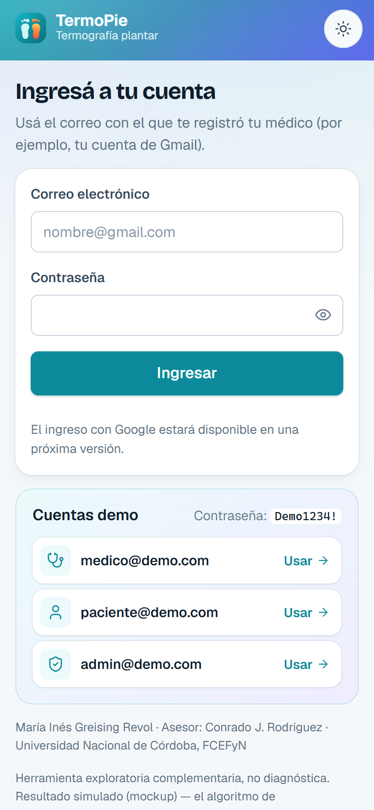 | 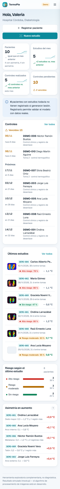 | 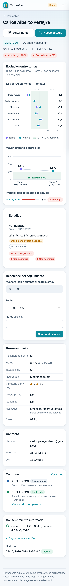 | 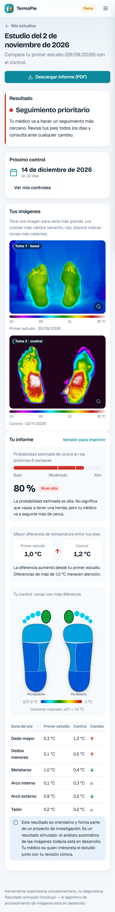 |

## Funcionalidades

**Médico/a**
- Tablero con KPIs y tendencia frente al mes anterior (con *sparklines*), distribución de riesgo, controles vencidos y próximos, últimos estudios con miniatura y cambio de asimetría ↑/↓, y pacientes con asimetría en aumento.
- **Estudios realizados**: búsqueda por nombre, apellido o código, filtros (fechas, centro, riesgo, grupo, publicado, desenlace), orden, paginado, tarjetas en móvil y CSV del filtro actual.
- **Controles**: pestañas Próximos / Vencidos / Realizados, ausencia con motivo, marcado automático al guardar la toma 2, línea de tiempo en la ficha y CSV.
- Registro de pacientes por su **correo (Gmail)**: verifica criterios de exclusión y consentimiento, crea la cuenta con contraseña temporal (se muestra una sola vez) y asigna el **código anónimo** (`P.<centro><nnn>`, p. ej. `P.HC901`; los pacientes demo usan `DEMO-001` … `DEMO-012`).
- Ficha clínica completa (DM, HbA1c con alerta >12 meses o imputada, tabaquismo «a consultar», neuropatía con puntaje y grado, vibratoria 0–50 / «>50», antecedentes, hallazgos, campos futuros) con evolución entre tomas sin doble eje (dumbbell por región, pendiente del |ΔT| máximo y probabilidad por estudio).
- **Asistente de estudio en 4 pasos** que sigue el protocolo: paciente, fechas de ambas tomas y consentimiento → condiciones ambientales (T 21–24 °C, HR 40–70 %, la humedad resaltada) y checklist de cámara → carga de **dos termografías: toma 1 (basal) y toma 2 (control ~30 días después)** (JPG/PNG/TIFF/IS2, arrastrar y soltar, vista previa; los IS2 de Fluke se previsualizan decodificando la matriz infrarroja en el servidor; la toma 1 puede reutilizarse de un estudio anterior) → análisis.
- Resultado **comparativo**: probabilidad a 6 semanas que considera la evolución (gauge con cortes 50/70 %), temperaturas absolutas por ROI de cada toma (6 por pie + general), ΔT por toma y **variación de la asimetría** (regiones que empeoran), **grupo térmico de cada toma, mostrado como «Con asimetría (P)» / «Sin asimetría (C)» con ayuda contextual, y simetría** con el umbral usado (1,0 °C por defecto; 2,2 °C de la literatura), mapas plantares lado a lado, factores contribuyentes y ficha del modelo de referencia.
- Notas, publicación del resultado al paciente, control a 6 semanas, **desenlace real** (¿generó lesión?, pie, ROI), informe imprimible («Guardar como PDF») y **exportación CSV** anonimizada con las columnas de la planilla del equipo.
- Gestión del **consentimiento informado** (historial, revocación).

**Paciente**: último resultado en lenguaje simple, estudios con imágenes (visor con paletas y escala en °C), **«Tu informe»** (probabilidad con nivel, mayor diferencia de temperatura en cada toma, mapa simplificado y tabla por región con ↑/↓/=, descargable en PDF) sólo cuando el médico lo publica, **mis controles**, autocuidado, sus datos y su consentimiento.

**Administrador/a**: alta de médicos, activación/desactivación, restablecimiento de contraseñas, estadísticas del sistema y **auditoría**. Por diseño no accede a datos clínicos.

## Inicio rápido

```bash
npm install
npm run dev          # http://localhost:3000 (driver memory con datos demo)
```

### Cuentas demo (contraseña `Demo1234!`)

| Rol | Usuario |
| --- | --- |
| Médico/a | `medico@demo.com` (también `medico2@demo.com`) |
| Paciente | `paciente@demo.com` (y 11 pacientes `*.demo@gmail.com`, p. ej. `maria.gomez.demo@gmail.com`) |
| Administrador/a | `admin@demo.com` |

Los pacientes y datos clínicos de demostración son **ficticios**. Las termografías demo son **termogramas reales anonimizados** del estudio (usados con autorización del equipo): sólo la matriz infrarroja de las plantas, renderizada con la paleta **Fluke High Contrast** derivada empíricamente de la cámara (y variantes Ironbow y Grises), sin fotos visibles, texto ni metadatos (ver `scripts/generate-demo-images.js`).

El tema por defecto es **claro**; el oscuro se activa con el botón ☀/☾ y se recuerda en el navegador.

## Scripts

| Script | Descripción |
| --- | --- |
| `npm run dev` | Servidor con recarga (`node --watch`). |
| `npm start` | Servidor en modo normal. |
| `npm test` | Pruebas unitarias e integración (Jest + supertest). |
| `SUPABASE_E2E=1 npm test -- tests/supabase` | Pruebas de extremo a extremo contra un proyecto Supabase real. |
| `npm run lint` | ESLint. |
| `npm run format` / `format:check` | Prettier. |
| `npm run generate:images` | Regenera las termografías demo de `public/demo` a partir de los IS2 de la carpeta privada `tesis-2026info/` (no versionada). |
| `npm run seed:supabase` | Carga la semilla demo en Supabase (Auth + DB + Storage). Admite `-- --reset`. |

## Arquitectura en una línea

MVC sobre Express 5 + EJS, capa de servicios, **Repository + Factory** (`DATA_DRIVER=memory|supabase`), **Strategy** para el predictor y la autenticación, **Observer** para la auditoría, **Chain of Responsibility** en los middlewares y una raíz de composición para la inyección de dependencias. Ver:

- [docs/arquitectura.md](docs/arquitectura.md) – capas, patrones y diagramas.
- [docs/modelo-datos.md](docs/modelo-datos.md) – diagrama ER y diccionario de datos.
- [docs/casos-de-uso.md](docs/casos-de-uso.md) – actores, casos de uso e historias de usuario.
- [docs/requerimientos.md](docs/requerimientos.md) – requerimientos funcionales, no funcionales y marco legal (Leyes 25.326 y 26.529).
- [docs/despliegue.md](docs/despliegue.md) – Vercel, Supabase, variables de entorno y cómo conectar el algoritmo real.

## Estructura

```
api/index.js            Entrada serverless (Vercel)
server.js               Entrada local
src/
  app.js                Aplicación Express (middlewares globales)
  container.js          Raíz de composición (DI)
  config/               Configuración (Singleton), dominio, clientes Supabase
  models/               Entidades + DTO PatientView
  repositories/         Contratos, Factory, drivers memory/ y supabase/
  services/             Casos de uso, predictores (Strategy), auth (Strategy)
  controllers/          Controladores MVC
  middlewares/          Auth/RBAC, CSRF, validación, flash, errores, layout
  routes/               Rutas y cadenas de middlewares
  validators/           Esquemas Zod e imágenes (firma binaria)
  views/                Vistas EJS por rol
  seed/                 Datos demo (compartidos por ambos drivers)
  utils/                Eventos, formato, CSV, colores térmicos
public/                 CSS (sistema de diseño), JS, imágenes demo
supabase/               Migraciones (esquema, RLS, storage) y seed
tests/                  unit/, integration/, supabase/ (e2e opcional)
docs/                   Documentación técnica y capturas
```

## Licencia

[MIT](LICENSE) © 2026 Autores del Proyecto Integrador – FCEFyN UNC.
