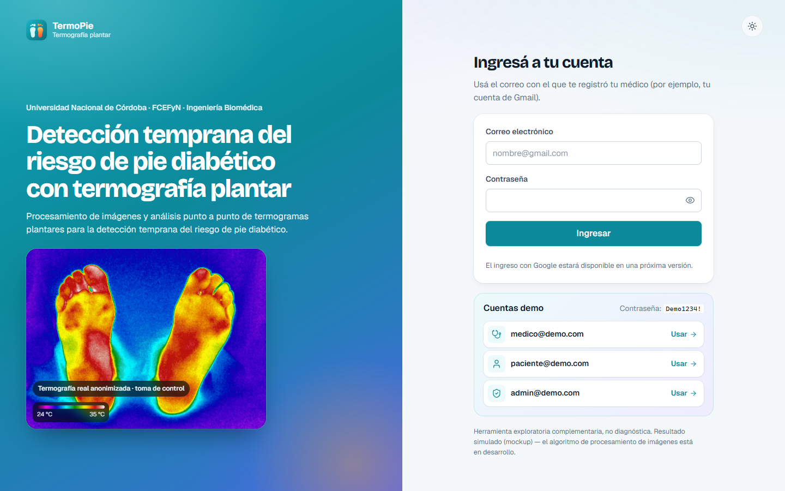
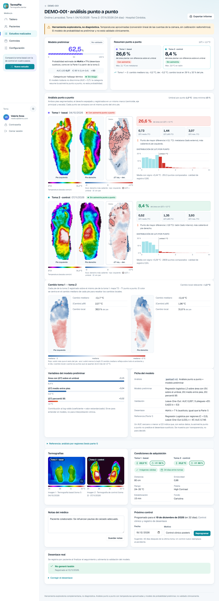
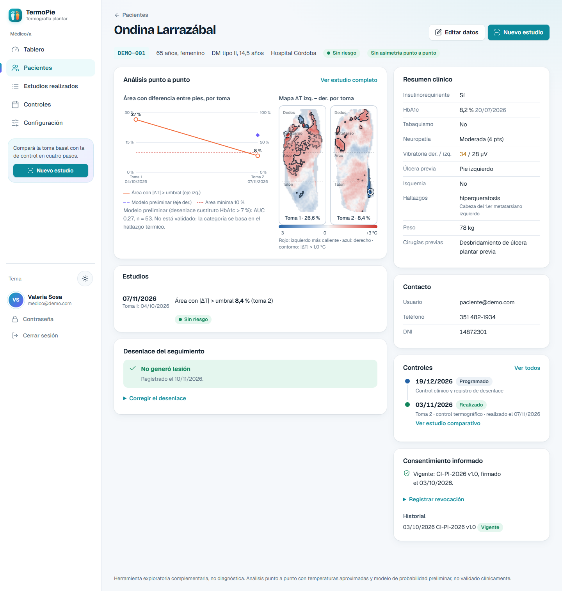
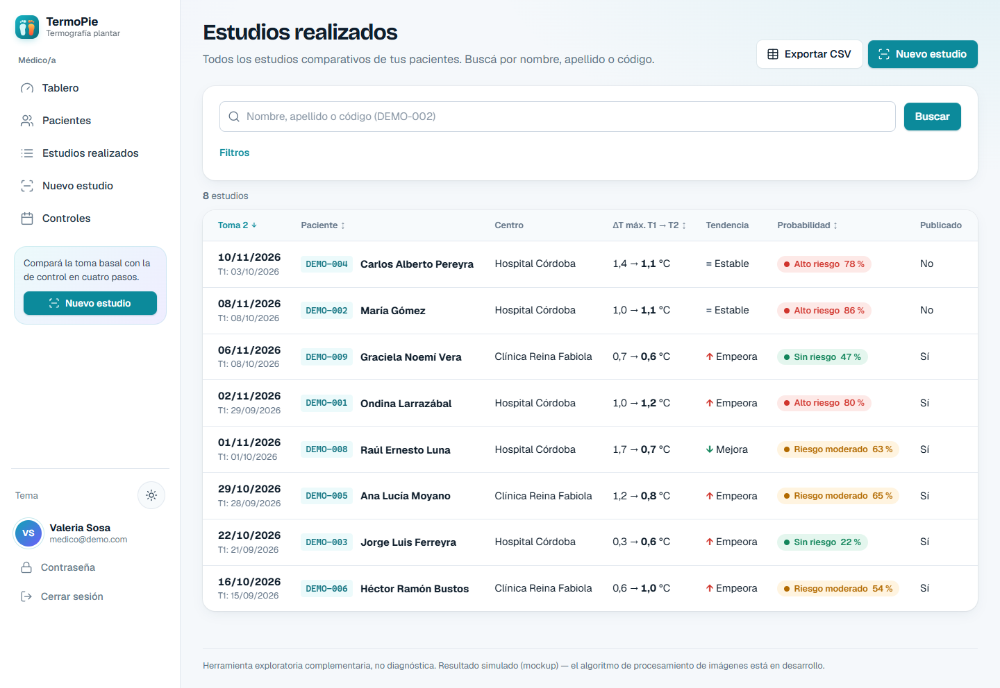
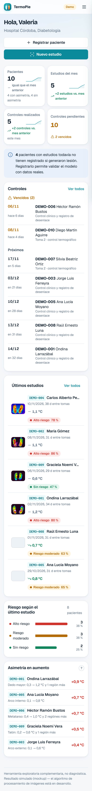
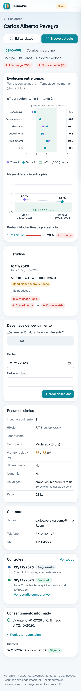

# TermoPie · Portal de termografía plantar


Portal médico–paciente para la **estimación del riesgo de úlcera de pie diabético a partir de termografía plantar**. Es la plataforma web del Proyecto Integrador de Ingeniería Biomédica (FCEFyN – Universidad Nacional de Córdoba):

> **«Procesamiento de imágenes y análisis punto a punto de termogramas plantares para la detección temprana del riesgo de pie diabético»**
> Alumna: María Inés Greising Revol · Asesor: Conrado J. Rodríguez · Co-asesoras: Dra. María Ranz y Álvarez, Dra. María Eugenia Lozano y Dra. Beatriz Alejandra García.
>
> Antecedente (Parte 1): «Correlación entre la termografía y la predicción de úlceras en pie diabético», Ana Paula Muñoz (FCEFyN – UNC).

> [!WARNING]
> **Herramienta exploratoria complementaria, no diagnóstica.** El análisis compara ambos pies **punto a punto**: segmentación, espejado del pie derecho, registro afín y mapa ΔT píxel a píxel. Las temperaturas son aproximadas (conversión lineal de las cuentas de la cámara).
>
> El resultado principal es el **riesgo de úlcera a 12 meses** (estrategia `riesgo-bibliografia`). Los cocientes de verosimilitud valen por períodos de 2 meses, así que el riesgo se calcula por período y se compone a 12 meses. Se calcula con el teorema de Bayes:
>
> - **Prior:** la incidencia del grupo de riesgo IWGDF del paciente (Peters y Lavery 2001).
> - **Cociente de verosimilitud:** el de la asimetría térmica de zona caliente contigua (Frykberg et al. 2017, *Diabetes Care* 40:973).
> - **Rango:** sale de los IC de esas cifras.
>
> Todavía no hay desenlaces de la cohorte para validarlo. Con ≥ 10 lesiones registradas, el portal pasa solo al modelo entrenado. Mientras tanto, si la ficha no registra neuropatía, el grupo IWGDF se estima con una CNN entrenada con la cohorte para detectar neuropatía desde el termograma (AUC 0,79; [§8.10](docs/arquitectura.md#810-modelo-entrenado-con-datos-propios-neuropatía-desde-el-termograma)). Método, citas y limitaciones en [docs/arquitectura.md §8.9](docs/arquitectura.md#89-riesgo-de-úlcera-calibrado-con-la-bibliografía-estrategia-por-defecto).

## Capturas

| Ingreso | Tablero del médico |
| --- | --- |
|  |  |
| **Resultado punto a punto (mapas ΔT, histograma, cambio entre tomas)** | **Ficha del paciente: evolución punto a punto** |
|  |  |
| **Estudios realizados** | **Controles** |
|  |  |
| **«Tu informe» (paciente)** | **Visor con paleta Fluke High Contrast** |
|  |  |
| **Asistente con vistas previas (PNG e IS2)** | **Tema oscuro (opcional)** |
|  |  |

Paletas disponibles en el visor (High Contrast, Ironbow, Grises): [docs/screenshots/12-paletas-comparacion.png](docs/screenshots/12-paletas-comparacion.png).

| Móvil: ingreso | Móvil: tablero | Móvil: evolución | Móvil: informe del paciente |
| --- | --- | --- | --- |
|  |  |  |  |

## Funcionalidades

**Médico/a**
- Tablero con KPIs y tendencia frente al mes anterior (con *sparklines*), distribución de riesgo, controles vencidos y próximos, últimos estudios con miniatura y % de área con asimetría punto a punto, y los pacientes con mayor asimetría punto a punto.
- **Estudios realizados**: búsqueda por nombre, apellido o código, filtros (fechas, centro, riesgo, grupo por regiones, desenlace), columna de % de área con \|ΔT\| sobre el umbral y marca de «sin toma 2», orden, paginado, tarjetas en móvil y CSV del filtro actual.
- **Controles**: pestañas Próximos / Vencidos / Realizados, ausencia con motivo, marcado automático al guardar la toma 2, línea de tiempo en la ficha y CSV.
- Registro de pacientes por su **correo (Gmail)**: verifica criterios de exclusión y consentimiento, crea la cuenta con contraseña temporal (se muestra una sola vez) y asigna el **código anónimo** (`P.<centro><nnn>`, p. ej. `P.HC901`; los pacientes demo usan `DEMO-001` … `DEMO-012`).
- Ficha clínica completa (DM, HbA1c con alerta >12 meses o imputada, tabaquismo «a consultar», neuropatía con puntaje y grado, vibratoria 0–50 / «>50», antecedentes, hallazgos, campos futuros), con la evolución punto a punto: % de área con asimetría por toma y probabilidad preliminar, más los mapas ΔT del último estudio.
- **Asistente de estudio en 4 pasos** que sigue el protocolo: paciente, fechas de ambas tomas y consentimiento → condiciones ambientales (T 21–24 °C, HR 40–70 %, la humedad resaltada) y checklist de cámara → carga de **dos termografías: toma 1 (basal) y toma 2 (control ~30 días después)** (JPG/PNG/TIFF/IS2, arrastrar y soltar, vista previa; los IS2 de Fluke se previsualizan decodificando la matriz infrarroja en el servidor; la toma 1 puede reutilizarse de un estudio anterior) → análisis.
- Resultado **punto a punto**:
  - mapas de cada pie, mapa **ΔT izq. − der.** con contorno del umbral y punto de mayor diferencia;
  - histograma de \|ΔT\| por punto y métricas (% de área sobre el umbral, \|ΔT\| medio, p95 y máximo);
  - mapa de **cambio toma 1 → toma 2** por pie;
  - aviso de **zonas no analizadas** («En este estudio no se analizó: dedos…»);
  - estudios **sin toma 2**;
  - probabilidad del **modelo preliminar** con su AUC y n, y la ficha del modelo.
  - Las 6 regiones por pie de la Parte 1 quedan como **referencia plegada**.
- Notas, control a 6 semanas, **desenlace real** (¿generó lesión?, pie, ROI), informe imprimible («Guardar como PDF») y **exportación CSV** anonimizada con las columnas de la planilla del equipo.
- Gestión del **consentimiento informado** (historial, revocación).

**Paciente**: último resultado en lenguaje simple, estudios con imágenes (visor con paletas y escala en °C), **«Qué mostró tu estudio»** («X de cada 100 puntos de la planta con más de 1 °C de diferencia», zona con más diferencia, mapa simplificado y zonas no analizadas, descargable en PDF), sin métricas del modelo; **mis controles**, autocuidado, sus datos y su consentimiento.

**Administrador/a**: alta de médicos, activación/desactivación, restablecimiento de contraseñas, estadísticas del sistema y **auditoría**. Por diseño no accede a datos clínicos.

## Inicio rápido

```bash
npm install
npm run dev          # http://localhost:3000 (driver memory con datos demo)
```

### Datos reales (sólo en el equipo local)

Los pacientes reales **nunca se versionan ni se despliegan**. Requieren la carpeta privada `tesis-2026info/` (no versionada):

```bash
npm run precompute:real   # tesis-2026info/ → data-local/real/ (ignorada por git y Vercel)
npm run train:model       # reentrena el modelo preliminar (sólo guarda agregados)
DATA_DRIVER=memory SEED=real npm start   # en PowerShell: $env:DATA_DRIVER='memory'; $env:SEED='real'; npm start
```

Con `SEED=real` se cargan todos los pacientes de la planilla con sus tomas. Las cuentas del personal se mantienen (`medico@demo.com`) y los pacientes `DEMO-…` no se cargan. Cada paciente tiene una cuenta de portal local `<código>@pacientes.local` (p. ej. `phc001@pacientes.local`, contraseña `Demo1234!`). Si falta `data-local/real/`, se usan los datos de demostración.

### Segmentación U-Net, TCI y comparación de modelos (local, Python + PyTorch CPU)

```bash
py -3.13 -m venv data-local/venv-ml          # entorno ignorado por git
data-local/venv-ml/Scripts/python -m pip install torch --index-url https://download.pytorch.org/whl/cpu
data-local/venv-ml/Scripts/python -m pip install numpy scipy scikit-learn pillow onnx onnxscript
npm run ml:export                             # IS2 → data-local/ml/cache
cd scripts/ml
../../data-local/venv-ml/Scripts/python selfcheck.py      # autocomprobación con datos sintéticos
../../data-local/venv-ml/Scripts/python build_labels.py   # etiquetas débiles mejoradas
../../data-local/venv-ml/Scripts/python train_unet.py 40  # U-Net (CPU) → data-local/models/ (+ ONNX)
../../data-local/venv-ml/Scripts/python segment_unet.py   # máscaras U-Net + métricas
cd ../.. && npm run precompute:real && npm run ml:features
cd scripts/ml && ../../data-local/venv-ml/Scripts/python train_models.py [--outcome hba1c7|lesion] [--export]
```

- **U-Net:** 4 niveles, entrenada con etiquetas débiles (segmentación clásica refinada) y división por paciente. En validación: Dice 0,98. Corre sólo offline; si no hay máscara U-Net, el portal usa la segmentación clásica.
- **TCI:** índice de cambio térmico de Hernández-Contreras et al. (2017), punto a punto sobre la grilla registrada. Usa angiosomas por atlas y, como referencia, el grupo control de la base pública 2019; si la base no está, los pacientes más simétricos de la cohorte (con leave-one-out).
- **Modelos con HbA1c > 7 %** (sustituto): ningún modelo supera el azar de forma convincente, ni siquiera con features invariantes y ajuste por centro. Por eso el portal ya no muestra esa probabilidad.

### Base pública 2019 y patrón térmico (local)

La base *Plantar Thermogram Database for the Study of Diabetic Foot Complications* (Hernández-Contreras et al., IEEE DataPort, DOI 10.21227/tm4t-9n15, licencia CC BY 4.0) va en una carpeta nueva bajo `data-local/public/hernandez2019/`, que nunca se versiona. Hay que descomprimir sólo los CSV y la planilla; no se ejecuta nada de la descarga.

```bash
npm run ml:public                              # base → grillas canónicas + atlas de angiosomas
npm run precompute:real && npm run ml:pattern  # TCI con la nueva referencia + features invariantes
data-local/venv-ml/Scripts/python -I scripts/ml/train_public.py --export   # diabetes vs control → src/config/models/
data-local/venv-ml/Scripts/python -I scripts/ml/train_adjusted.py          # HbA1c con features invariantes y ajuste por centro
npm run ml:summary                             # agrega los resultados a «Detalle técnico»
data-local/venv-ml/Scripts/python -I scripts/ml/dice_public.py             # control de dominio de la U-Net
data-local/venv-ml/Scripts/python -I scripts/ml/dice_corrected.py          # Dice vs máscaras corregidas en /mascaras
data-local/venv-ml/Scripts/python -I scripts/ml/train-outcome.py           # modelo de úlcera (se niega con < 10 lesiones) → data-local/models/
data-local/venv-ml/Scripts/python -I scripts/ml/train_riskfactor.py       # factores de riesgo (neuropatía…) desde el termograma, todas las variantes
data-local/venv-ml/Scripts/python -I scripts/ml/check_riskfactor_cnn.py --export  # controles de la CNN de neuropatía → data-local/models/
npm run ml:forecast                            # pronóstico por zona toma 1 → toma 2 → data-local/models/forecast-zones.json
node scripts/ml/export-forecast.js --retest    # (opcional) ruido test-retest entre réplicas de una misma toma
```

- **Patrón térmico compatible con pie diabético:** se entrena diabetes vs control en la base pública. Con validación cruzada por sujeto da AUC 0,91 (0,86–0,95), n = 167. **No predice úlcera.** Queda como dato secundario en «Detalle técnico» y no cambia el riesgo ni su categoría. Los controles de la base son más jóvenes, así que parte de la señal puede ser la edad.
- **Atlas de angiosomas:** `npm run ml:public` lo escribe en `data-local/models/angiosome-atlas.json`. Como deriva de la base pública, no se versiona; si falta (CI, Vercel), el TCI usa la aproximación geométrica.
- **Modelo de úlcera:** `train-outcome.py` escribe `data-local/models/outcome-logreg.json` si hay casos suficientes. Si queda validado, el portal lo usa en lugar del riesgo bibliográfico (`RIESGO_MODELO=auto|bibliografia|entrenado`).
- **Neuropatía desde el termograma:** CNN preentrenada con la base pública y ajustada con la neuropatía de la planilla: AUC 0,79 (0,68–0,89), 0,84 dentro del Hospital Córdoba, n = 70. Si la ficha no registra neuropatía, define el prior IWGDF del riesgo (`riesgo-neuropatia`). Los pesos quedan en `data-local/models/`.
- **Pronóstico por zona del próximo control:** regresión a la media por pie × zona desde la última toma, con rango del 80 %, probabilidad de zona caliente y mapa β · ΔT. En CV por paciente: área MAE 9,2 pp (persistencia 9,7), ΔT 0,37 °C (0,42), AUC 0,75 (0,69–0,80); test-retest 2,4 pp / 0,26 °C. Marca las **zonas calientes persistentes** (≥ 10 % en ambas tomas) y, aparte, la **alerta IWGDF** de asimetría ≥ 2,2 °C persistente (p95 de la zona en ambas tomas). Sólo hay dos tomas: el pronóstico a varios pasos no está validado ([§8.11](docs/arquitectura.md#811-pronóstico-térmico-por-zona-próximo-control)).
- **Corrección de máscaras:** en `/mascaras` (sólo local), el médico/a o el administrador/a corrige el contorno de los pies. Las máscaras se guardan en `data-local/ml/corrected-masks/`.
- **Desenlace real:** con datos reales, se guarda también en `data-local/outcomes/outcomes.json`, así se conserva al reiniciar.

Detalle en [docs/arquitectura.md §8.3–8.11](docs/arquitectura.md). Los pesos, máscaras y matrices quedan en `data-local/`; nunca se versionan.

### Cuentas demo (contraseña `Demo1234!`)

| Rol | Usuario |
| --- | --- |
| Médico/a | `medico@demo.com` (también `medico2@demo.com`) |
| Paciente | `paciente@demo.com` (y 11 pacientes `*.demo@gmail.com`, p. ej. `maria.gomez.demo@gmail.com`) |
| Administrador/a | `admin@demo.com` |

Estas cuentas son sólo para la ejecución local. La producción usa credenciales privadas: las contraseñas demo no funcionan allí.

Los pacientes y datos clínicos de demostración son **ficticios**. Las termografías demo son **termogramas reales anonimizados** del estudio (usados con autorización del equipo): sólo la matriz infrarroja de las plantas, renderizada con la paleta **Fluke High Contrast** derivada empíricamente de la cámara (y variantes Ironbow y Grises), sin fotos visibles, texto ni metadatos (ver `scripts/generate-demo-images.js`).

El tema por defecto es **claro**; el oscuro se activa con el botón ☀/☾ y se recuerda en el navegador.

## Scripts

| Script | Descripción |
| --- | --- |
| `npm run dev` | Servidor con recarga (`node --watch`). |
| `npm start` | Servidor en modo normal. |
| `npm test` | Pruebas unitarias e integración (Jest + supertest). |
| `SUPABASE_E2E=1 npm test -- tests/supabase` | Pruebas de extremo a extremo contra un proyecto Supabase real. |
| `npm run lint` | ESLint. |
| `npm run format` / `format:check` | Prettier. |
| `npm run generate:images` | Regenera las termografías demo de `public/demo` a partir de los IS2 de la carpeta privada `tesis-2026info/` (no versionada). |
| `npm run precompute:real` | Análisis punto a punto de todos los pacientes reales (`tesis-2026info/` → `data-local/real/`, local). |
| `npm run train:model` | Entrena y valida (LOO y 5 pliegues ×20) el modelo preliminar; escribe `src/config/models/pointwise-logreg.json` (sólo agregados). |
| `npm run ml:export` | Exporta las réplicas IS2 reales a `data-local/ml/cache` (.npy) para la U-Net (local). |
| `npm run ml:features` | Exporta features y mapas registrados para comparar modelos (local). |
| `npm run ml:public` | Registra la base pública 2019 a la grilla canónica y regenera el atlas de angiosomas (local). |
| `npm run ml:pattern` | Exporta features invariantes de la base pública y de la cohorte (local). |
| `npm run ml:summary` | Agrega los resultados de `train_public.py` y `train_adjusted.py` a `src/config/models/model-comparison.json`. |
| `npm run ml:forecast` | Exporta los pares toma 1 → toma 2 y entrena el pronóstico por zona (`data-local/models/forecast-zones.json`, local, no se versiona). |
| `npm run generate:pointwise` | Regenera las grillas punto a punto de los pares demo (`src/seed/demoPointwise.json`). |
| `npm run seed:supabase` | Carga la semilla demo en Supabase (Auth + DB + Storage). Admite `-- --reset`. |

## Arquitectura en una línea

MVC sobre Express 5 + EJS, capa de servicios, **Repository + Factory** (`DATA_DRIVER=memory|supabase`), **Strategy** para el predictor y la autenticación, **Observer** para la auditoría, **Chain of Responsibility** en los middlewares y una raíz de composición para la inyección de dependencias. Ver:

- [docs/arquitectura.md](docs/arquitectura.md) – capas, patrones y diagramas.
- [docs/modelo-datos.md](docs/modelo-datos.md) – diagrama ER y diccionario de datos.
- [docs/casos-de-uso.md](docs/casos-de-uso.md) – actores, casos de uso e historias de usuario.
- [docs/requerimientos.md](docs/requerimientos.md) – requerimientos funcionales, no funcionales y marco legal (Leyes 25.326 y 26.529).
- [docs/despliegue.md](docs/despliegue.md) – Vercel, Supabase, variables de entorno y cómo conectar el algoritmo real.

## Estructura

```
api/index.js            Entrada serverless (Vercel)
server.js               Entrada local
src/
  app.js                Aplicación Express (middlewares globales)
  container.js          Raíz de composición (DI)
  config/               Configuración (Singleton), dominio, clientes Supabase
  models/               Entidades + DTO PatientView
  repositories/         Contratos, Factory, drivers memory/ y supabase/
  services/             Casos de uso, predictores (Strategy), auth (Strategy)
  controllers/          Controladores MVC
  middlewares/          Auth/RBAC, CSRF, validación, flash, errores, layout
  routes/               Rutas y cadenas de middlewares
  validators/           Esquemas Zod e imágenes (firma binaria)
  views/                Vistas EJS por rol
  seed/                 Datos demo (compartidos por ambos drivers)
  utils/                Eventos, formato, CSV, colores térmicos
public/                 CSS (sistema de diseño), JS, imágenes demo
supabase/               Migraciones (esquema, RLS, storage) y seed
tests/                  unit/, integration/, supabase/ (e2e opcional)
docs/                   Documentación técnica y capturas
```

## Licencia

[MIT](LICENSE) © 2026 Autores del Proyecto Integrador – FCEFyN UNC.
