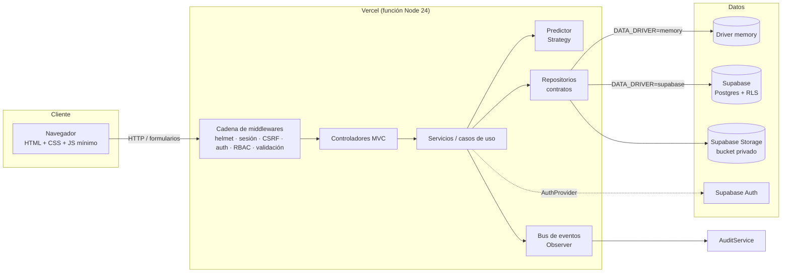
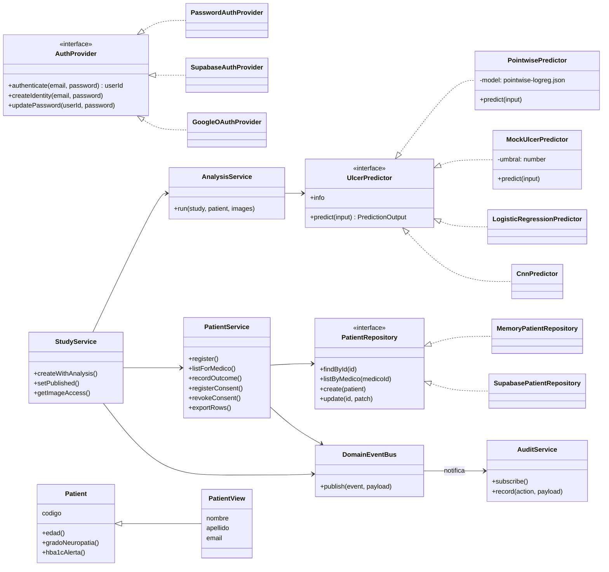
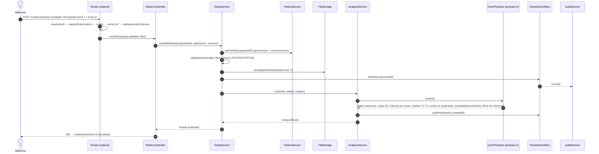
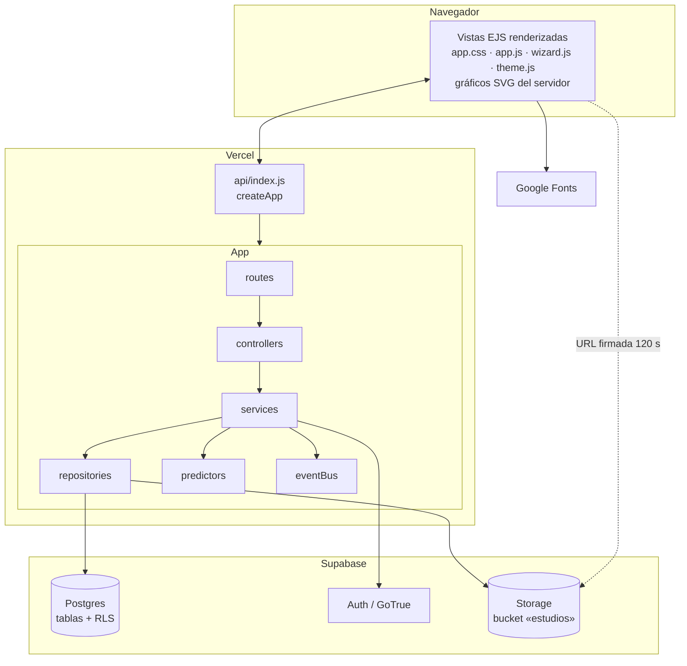
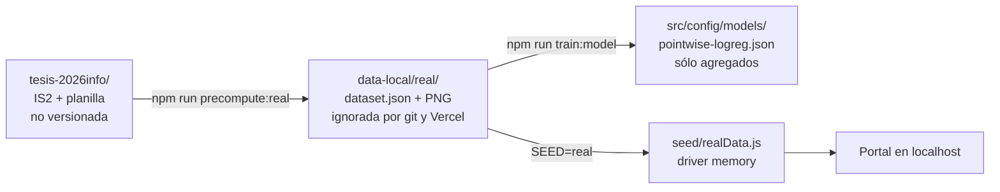

# Arquitectura

Este documento describe la arquitectura del portal TermoPie, las decisiones de diseño y los patrones utilizados, indicando **dónde** se aplica cada uno en el código.

## 1. Vista general

El sistema es una aplicación web monolítica **server-side rendered** (Express 5 + EJS) organizada en capas, desplegable como función serverless en Vercel. La persistencia es intercambiable: en memoria (demostración) o Supabase (Postgres + Auth + Storage).



### Capas

| Capa | Carpeta | Responsabilidad |
| --- | --- | --- |
| Presentación (Vista) | `src/views`, `public/` | Plantillas EJS por rol, sistema de diseño en un único CSS, JS de mejora progresiva. |
| Presentación (Controlador) | `src/controllers`, `src/routes` | Traducir HTTP ↔ casos de uso. Sin reglas de negocio. |
| Middlewares | `src/middlewares` | Seguridad, sesión, autorización, validación, errores, layout. |
| Aplicación (Servicios) | `src/services` | Casos de uso: registrar paciente, crear estudio + análisis, publicar, etc. |
| Dominio | `src/models`, `src/config/domain.js` | Entidades, reglas derivadas (edad, grado de neuropatía, grupo térmico) y constantes del protocolo. |
| Infraestructura | `src/repositories`, `src/config/supabase.js`, `src/services/auth/*Provider.js` | Persistencia, almacenamiento de archivos y proveedores de identidad. |
| Procesamiento de imágenes | `src/imaging` | Lectura de IS2 (ZIP + matriz IR 320×240), segmentación de ambos pies, ROIs aproximadas, conversión cuentas→°C y renderizado ironbow (vistas previas). |

## 2. Patrones de diseño

| Patrón | Dónde | Para qué |
| --- | --- | --- |
| **MVC** | `controllers/`, `views/`, `models/` | Separar presentación, control y dominio. |
| **Repository** | `repositories/contracts.js` (interfaces), `repositories/memory`, `repositories/supabase` | Aislar a los servicios de la tecnología de persistencia. |
| **Factory** | `repositories/RepositoryFactory.js` (`DATA_DRIVER`), `services/predictors/PredictorFactory.js` (`PREDICTOR`) | Elegir implementaciones concretas por configuración. |
| **Strategy** | `services/predictors/UlcerPredictor.js` → `LiteratureRiskPredictor` (por defecto: riesgo de úlcera calibrado con la bibliografía sobre el análisis punto a punto, §8.9), `TrainedOutcomePredictor` (modelo entrenado con los desenlaces, cuando está validado), `PointwisePredictor` (análisis punto a punto + modelo preliminar), `MockUlcerPredictor` (respaldo para imágenes no radiométricas), `LogisticRegressionPredictor`, `CnnPredictor`; `services/auth/AuthProvider.js` → `PasswordAuthProvider`, `SupabaseAuthProvider`, `GoogleOAuthProvider` | Intercambiar el algoritmo de predicción y el mecanismo de autenticación sin tocar los casos de uso. |
| **Singleton** | `config/index.js` (`getConfig`), `config/supabase.js` (`getSupabaseClients`) | Una sola configuración inmutable y un único cliente de base de datos por proceso. |
| **Chain of Responsibility** | `app.js` (cadena global) y `routes/index.js` (`requireAuth → requireRole → multer → verifyCsrf → validate → controlador`) | Cada eslabón decide si corta (redirección, 403, error de validación) o delega. |
| **Observer** | `utils/eventBus.js` (`DomainEventBus`), `services/AuditService.js` | Los servicios publican eventos (`patient.created`, `analysis.completed`, …) y la auditoría se suscribe sin acoplamiento. |
| **DTO / Mapper** | `models/PatientView.js`, `repositories/supabase/mappers.js`, `utils/csv.js` | Combinar ficha clínica + perfil sólo para presentación; mapear camelCase ↔ snake_case; exportar CSV anonimizado. |
| **Service Layer** | `services/*Service.js` | Orquestar casos de uso y reglas (exclusión, consentimiento, pertenencia de objetos). |
| **Inyección de dependencias** | `container.js` (raíz de composición) | Único lugar donde se instancian clases concretas; los tests pueden reemplazar piezas. |

### Principios SOLID aplicados

- **S**: cada servicio cubre un agregado (pacientes, estudios, controles, auditoría).
- **O**: nuevos predictores, proveedores de identidad o suscriptores de eventos se agregan sin modificar los servicios.
- **L**: cualquier implementación de un contrato de repositorio funciona en su lugar (las pruebas e2e ejecutan los mismos flujos con Supabase).
- **I**: contratos pequeños por agregado (`StudyRepository`, `ConsentRepository`, `FileStorage`, …).
- **D**: los servicios dependen de abstracciones inyectadas, nunca de `@supabase/supabase-js` directamente.

## 3. Diagrama de clases (núcleo)



## 4. Diagrama de secuencia: carga de estudio y análisis



## 5. Diagrama de componentes y despliegue



## 5.1 Visualización de datos

Los gráficos del análisis punto a punto se dibujan en **canvas** en el navegador (`public/js/pointwise.js`). Lee las grillas desde un `<script type="application/json">`, que no se ejecuta y respeta la CSP `script-src 'self'`. Los gráficos de resumen se generan como **SVG en el servidor** (`pw-evolution`, `sparkline`, `gauge`, `plantar-map`). No se usa ninguna librería de gráficos.

- **Mapas por toma:** pie izquierdo y derecho con escala de temperatura común (High Contrast), y mapa **ΔT izq. − der.** con escala divergente azul–blanco–rojo fija en ±3 °C, contorno de \|ΔT\| > umbral, guías de zona, marca del punto de mayor diferencia y gris para las celdas sin par.
- **Histograma** de \|ΔT\| por punto (paso 0,2 °C), con la línea del umbral; las barras sobre el umbral van en rojo.
- **Cambio toma 1 → toma 2** por pie (T2 − T1), con el color centrado en el cambio mediano y el valor de esa mediana informado.
- **Ficha del paciente:** evolución del % de área caliente por toma (eje izquierdo) y de la probabilidad preliminar (eje derecho, línea discontinua y marcadores distintos), con la línea del área mínima. Al lado, los mapas ΔT del último estudio.
- Se eliminaron el bloque «Evolución entre tomas» (dumbbell por región, pendiente del \|ΔT\| máximo, «Toma 1: con asimetría → Toma 2…») y el bloque «Visibilidad para el paciente». El resumen en lenguaje simple queda visible para el paciente al terminar el análisis.
- **Colores de serie:** toma 1 `#7b6cf6`, toma 2 `#0a94a8`. Cada gráfico tiene `aria-label` o `<title>` en español.

### Paleta térmica Fluke High Contrast

La paleta por defecto reproduce la «High Contrast» de la cámara Fluke. La LUT de 256 colores (`src/config/palettes/high-contrast.json`) se **derivó empíricamente** de la barra de color que la cámara incrusta en la miniatura JPEG de cada `.IS2` (columna x 313–317, de y = 26 a y = 181): mediana de 52 miniaturas, mediana móvil de 5 filas y suavizado gaussiano. Se validó con ΔE76 contra la propia imagen de la miniatura, modelando la fusión IR-visible de la cámara (α ≈ 0,75; mediana ≈ 10). El rango de cada imagen se calibra contra su miniatura (`src/imaging/flukeCalibration.js`) con un percentil como respaldo. Las miniaturas nunca se publican. El visor permite alternar **High Contrast / Ironbow / Grises** (variantes pre-renderizadas para las imágenes demo; render al vuelo para IS2) y muestra la escala en °C.

### Identidad

El logo (`public/img/logo.svg`) muestra dos plantas sobre un mosaico verde azulado: la izquierda fría y la derecha cálida, que representan la asimetría térmica que mide el estudio. Se eligió entre tres variantes (`docs/screenshots/logo-variantes.png`) por legibilidad a 16 px y por no depender del color para leerse. Se generan `favicon.svg`, `favicon.ico` (16 + 32), `apple-touch-icon.png` (180), íconos 192/512 y maskable para el `manifest.webmanifest`.

## 6. Seguridad

- **Sesión**: cookie firmada `httpOnly`, `SameSite=Lax`, `Secure` en producción, 8 h; el contenido se reemplaza completo al iniciar sesión (sin fijación de sesión). Apta para serverless (sin almacenamiento de sesión en servidor).
- **CSRF**: token sincronizado por sesión en todos los formularios; para `multipart` se verifica después de `multer`.
- **Cabeceras**: `helmet` con CSP estricta (`script-src 'self'`, sin scripts en línea ni CDN de scripts), `frame-ancestors 'none'`, `nosniff`.
- **Fuerza bruta**: `express-rate-limit` en `POST /login`; mensajes de error genéricos y hash constante para usuarios inexistentes (evita enumeración por tiempo).
- **Validación**: Zod en todos los formularios; imágenes validadas por **firma binaria**, no por extensión; tamaño máximo configurable.
- **Autorización**: RBAC por rol + control a nivel de objeto en servicios (un médico sólo ve sus pacientes; un paciente sólo lo suyo; el administrador no ve datos clínicos). En Supabase, además, **RLS** por rol.
- **Archivos**: bucket privado; el servidor entrega URLs firmadas de corta duración tras verificar permisos.
- **Contraseñas**: bcrypt (driver memory) o Supabase Auth; contraseñas temporales con cambio obligatorio en el primer ingreso.
- **Auditoría**: todos los eventos relevantes quedan registrados con actor, entidad, detalle e IP.

## 7. Decisiones y alternativas

| Decisión | Alternativa descartada | Motivo |
| --- | --- | --- |
| SSR con EJS y JS mínimo | SPA (React) | Menor complejidad, mejor accesibilidad base, despliegue serverless simple. |
| Cookie firmada | Sesiones en Redis/DB | Vercel no garantiza estado entre invocaciones. |
| Service-role en servidor + RLS como defensa en profundidad | Cliente con anon key + JWT por usuario | El control fino ya está en los servicios; RLS protege ante una fuga de la anon key o futuros clientes directos. |
| Driver `memory` por defecto | Base de datos obligatoria | Permite demostrar el producto sin infraestructura. |
| Ficha clínica seudonimizada (`codigo`) separada del perfil | Una sola tabla de pacientes | Minimización de datos (Ley 25.326) y exportaciones anonimizadas. |

## 8. Análisis punto a punto (Parte 2)

El análisis principal del portal compara los pies **punto a punto (píxel a píxel)**. Las 6 regiones por pie de la Parte 1 se siguen calculando, pero sólo como **referencia secundaria**. Se obtienen de la misma grilla registrada y se muestran plegadas en «Referencia: análisis por regiones (tesis parte 1)».

| Paso | Módulo | Detalle |
| --- | --- | --- |
| 1. Lectura | `src/imaging/is2.js` | Matriz `Images/Main/IR.data` del `.IS2` (320 × 240 cuentas, la primera fila es cabecera). Nunca se usan las fotos visibles. |
| 2. Cuentas → °C | `src/imaging/thermogram.js` (`toCelsius`) | Ajuste lineal aproximado (r ≈ 0,88). No es una calibración radiométrica: las temperaturas son **aproximadas** y las diferencias entre pies son más confiables que los valores absolutos. |
| 3. Segmentación | `scripts/ml/` (U-Net, §8.3) y `src/imaging/segmentation.js` (clásica) | Si existe la máscara de la **U-Net** (precálculo local) se usa esa; si no, o si no es plausible, la clásica. Clásica: suavizado 3×3 y umbral de Otsu. Si más del 40 % del cuadro queda tibio, se repite Otsu sobre esa parte. Semillas en el núcleo caliente de cada pie; para un pie mucho más frío, la semilla se busca en su mitad de la imagen con un umbral propio. Luego viene un **crecimiento de regiones competitivo** (inundación desde lo más caliente): un punto se agrega si el descenso respecto del vecino es < 0,25 °C y está a menos de 40 px de la semilla. Así los dedos fríos se incluyen y la tela o la pierna, separadas por un salto brusco, no. Termina con apertura morfológica, relleno de huecos y componente mayor. |
| 4. Espejado | `src/imaging/pointwise.js` | Convención del equipo: el pie a la izquierda de la imagen es el izquierdo. El derecho se espeja (x → W − 1 − x) para que ambos tengan el lado medial hacia +x. |
| 5. Registro | `footFrame` / `lengthFrames` | Registro **afín** a un marco canónico por pie: **centroide + eje principal** (momentos de segundo orden) + **escala anisótropa** (largo por percentiles 0,5–99,5 % sobre el eje; ancho medido en el antepié). Se hace en dos pasadas: la segunda descarta los puntos fuera del ancho del antepié, como una cuña de pierna junto al talón, antes de recalcular el eje. No se deforma el pie (no es un registro elástico). |
| 6. Grilla canónica | `sampleCanonical` | 40 × 100 celdas por pie, con remuestreo bilineal. La fila 0 es la punta de los dedos y la última el talón; la columna 0 es el borde lateral. Se descarta 1 px de contorno (mezcla piel/fondo). Fuera de la máscara la celda queda **sin dato** (NaN). |
| 7. Mapa ΔT | `asymmetryMetrics` | **ΔT = T(izquierdo) − T(derecho espejado)** en las celdas con dato en ambos pies. Positivo: el pie izquierdo está más caliente. Métricas: % del área con \|ΔT\| > umbral por punto; \|ΔT\| medio, p95 y máximo (este último sobre el mapa suavizado 3×3 para no reaccionar a un píxel aislado); media con signo; ubicación del punto de mayor diferencia (zona, lado medial/lateral y pie más caliente). |
| 8. Cambio entre tomas | `changeMetrics` | Cada pie de la toma 2 cae en la misma grilla canónica que el de la toma 1, así que el mapa **T2 − T1** se compara celda a celda. Se informa el cambio mediano (refleja sobre todo el ambiente y el día), el p95 y el % de «cambio local»: puntos que se apartan de la mediana más que el umbral configurable. En pantalla, el color se centra en la mediana de cada pie; los valores no se alteran. |
| 9. Zonas no analizadas | `zoneCoverage` | Si un pie toca el borde de la imagen (dedos o talón fuera del cuadro) o es más de un 12 % más corto que el otro, se ancla en su extremo íntegro y se usa la longitud esperada. La parte faltante queda sin dato. Una zona (dedos 0–20 %, metatarso 20–42 %, arco 42–70 %, talón 70–100 % del largo) con menos del 50 % de celdas comparables se **excluye de las métricas** y se informa: «En este estudio no se analizó: dedos. Se analizó: metatarso, arco y talón». |

Reglas que no se negocian: **no se usa IA generativa ni *inpainting*** y **nunca se modifican ni completan temperaturas**. Sólo se recorta, centra y alinea para mostrar, y las zonas sin dato se pintan en gris.

Parámetros (Configuración → «Análisis punto a punto», con vista previa del efecto):

- umbral por punto, 1,0 °C;
- área mínima para marcar «con asimetría punto a punto», 10 %;
- cambio local relevante entre tomas, 1,0 °C.

Los 10 % se calibraron con la toma 1 de los 54 pacientes de la hoja «DifT°» de la Parte 1. Con ese valor se marcan 27 tomas (la Parte 1 clasificó 26 como P) y la clasificación coincide en 43 de 54. Como las grillas se guardan en cada análisis, cambiar un parámetro y recalcular **no vuelve a procesar las imágenes**.

**Concordancia con la Parte 1.** El ΔT general por regiones calculado sobre la grilla tiene r = 0,84 con la planilla del equipo (54 pacientes, toma 1), con una diferencia mediana de 0,09 °C (con la segmentación clásica: r = 0,83). El script de entrenamiento lo vuelve a calcular.

### 8.1 Modelo preliminar (HbA1c, retirado de la interfaz)

`PointwisePredictor` (`puntual-v1`, `PREDICTOR=puntual`) hace el análisis punto a punto detrás de la interfaz `UlcerPredictor`. La estrategia por defecto, `LiteratureRiskPredictor` (§8.9), lo extiende. `MockUlcerPredictor` queda como respaldo sólo cuando se suben imágenes no radiométricas (JPG/PNG), y el resultado se rotula «simulado».

- **Variables:** % de área con \|ΔT\| > 1 °C, \|ΔT\| medio y \|ΔT\| p95 de la última toma, con el umbral fijo del modelo.
- **Ajuste:** regresión logística L2, C = 0,5 como en la Parte 1 (`src/services/predictors/logistic.js`).
- **Desenlace:** el mismo sustituto que la Parte 1, **HbA1c > 7 %**, porque en la cohorte casi no hubo úlceras registradas.
- **Muestra:** pacientes con HbA1c y toma 1 analizable. Se excluyen los marcados «PACIENTE NO VALIDO» en la planilla: **n = 53**, 35 positivos.
- **Validación** (reentrenado con la segmentación U-Net):
  - leave-one-out, con la estandarización dentro de cada pliegue: **AUC 0,02** (IC 95 % bootstrap 0–0,05);
  - 5 pliegues estratificados × 20 repeticiones: AUC medio 0,31;
  - AUC univariados 0,50–0,52;
  - con la segmentación clásica eran 0,27 (LOO) y 0,42 (5 × 20). La caída no indica un modelo «peor»: sin señal, la validación cruzada en muestras chicas tiene un sesgo negativo conocido, extremo en LOO;
  - comparación con los demás modelos en §8.5.
- **Conclusión:** con estos datos, **la asimetría punto a punto no predice el desenlace sustituto**. El AUC LOO menor a 0,5 es el sesgo conocido de LOO cuando no hay señal. Por eso:
  - **la probabilidad ya no se muestra**: ni en el estudio, ni en el informe, ni en el gráfico de la ficha, ni en el CSV. En su lugar se informa el patrón térmico compatible con pie diabético (§8.6), que tiene una etiqueta real y validada pero **no predice úlcera**. El modelo se sigue calculando internamente, sólo para comparar;
  - mientras el AUC de validación sea < 0,7, la **categoría** (sin riesgo / moderado / alto) se toma del **hallazgo térmico** y no de la probabilidad: sin asimetría → sin riesgo; área ≥ mínima → moderado; además con \|ΔT\| p95 ≥ 2,2 °C → alto.
- **Archivos:** los coeficientes, medias, desvíos y métricas agregadas están en `src/config/models/pointwise-logreg.json`, sin datos por paciente. Se regeneran con `npm run train:model`.

**Limitaciones (a validar por el equipo):**

- La conversión a °C es aproximada.
- El registro es afín, sin correspondencia anatómica fina (dedos individuales).
- La segmentación puede incluir tela o pierna junto al talón, o perder dedos fríos; el resultado se marca «Segmentación a revisar» si la calidad es < 0,6. La U-Net (§8.3) reduce mucho estos casos, pero aprendió de etiquetas débiles y no de contornos manuales.
- Las zonas «no analizadas» pueden deberse a dedos fuera del cuadro o a dedos demasiado fríos para segmentarlos.
- Algunas cámaras tenían el reloj desconfigurado: esas fechas se estiman y se avisa en las notas.
- El desenlace es sustituto y el n es chico.

### 8.2 Datos reales sólo en local



- `scripts/precompute-real.js` procesa todas las réplicas `.IS2` de cada toma y elige la de mejor calidad: solapamiento y simetría de las máscaras, penalizando los cortes. Renderiza esa toma con High Contrast y guarda sus grillas en `data-local/real/`. No imprime nombres, DNI ni teléfonos.
- Los pacientes cuya fila de la planilla tiene la marca de que **no dieron su consentimiento** («sin consentimiento», «no firmó el consentimiento», incluso con errores de tipeo; regla genérica en `src/utils/consent.js`) se **excluyen por completo**: no se procesan sus tomas ni se generan imágenes, no entran al dataset ni al entrenamiento, y el cargador los vuelve a descartar por si acaso.
- Con `SEED=real` y esa carpeta presente, el contenedor carga los pacientes reales en el driver `memory`. Se conservan las cuentas del personal de demostración y se quitan los pacientes `DEMO-…`. Las imágenes se leen del disco al pedirlas (montaje de sólo lectura en el `FileStorage`), sin cargarlas en memoria.
- Sin la carpeta (CI, Vercel, pruebas), el portal usa la semilla de demostración. Sus grillas punto a punto están en `src/seed/demoPointwise.json`: termogramas ya anonimizados, sin datos de identidad.

### 8.3 Segmentación con U-Net (offline)

La segmentación clásica falla sobre todo por **dedos fríos que quedan afuera** y por **puentes de tela entre los talones**; las fugas de pierna más allá del talón son raras. Para eso se entrenó una U-Net chica, sólo en CPU.

| Paso | Script | Detalle |
| --- | --- | --- |
| Exportación | `scripts/ml/export-seg-data.js` (`npm run ml:export`) | Cada réplica IS2 de los pacientes con consentimiento → temperatura (`.npy`, 240 × 320) y máscara clásica. Clave = hash de la ruta (las carpetas pueden tener nombres). Todo en `data-local/ml/`. |
| Etiquetas débiles | `build_labels.py` | Máscara clásica + apertura 3 × 3, componente mayor y relleno de huecos; **prior de forma** en el talón (largo / ancho del antepié ≤ 3,4 y recorte lateral del último 30 % a más de 0,6 anchos del eje); **recuperación de dedos fríos** con Otsu local, sólo hacia los dedos y dentro del ancho del antepié. Subconjunto «limpio» para entrenar: calidad clásica ≥ 0,6, largo / ancho 2,1–3,4 por pie y áreas parecidas (484 de 606 imágenes). |
| Modelo | `train_unet.py` | U-Net de 4 niveles (16-32-64-128 canales, 0,48 M parámetros). Entrada: temperatura normalizada por imagen (percentiles 1–99), reducida a 120 × 160. Salida: 3 clases (fondo, pie a la izquierda, pie a la derecha). Pérdida: entropía cruzada + Dice. Aumento: espejado (intercambiando las clases), rotación ± 10°, escala ± 10 %, desplazamiento, contraste / brillo / gamma y ruido. 40 épocas, lotes de 8, 3 hilos. |
| División | | **Por paciente**: 20 % de los pacientes a validación (21 pacientes, 131 imágenes; 111 limpias). |
| Inferencia | `segment_unet.py` | Logits reescalados a 240 × 320, argmax, apertura, componente mayor y relleno por pie → `data-local/ml/unet-masks/`. Exportado también a ONNX (`data-local/models/unet-feet.onnx`, 1,9 MB). |
| Autocomprobación | `selfcheck.py` | Datos sintéticos: prior de forma, post-proceso, división por paciente, formas de la red y validación cruzada. |

Resultados (contra la etiqueta débil, pacientes de validación):

- imágenes limpias: **Dice 0,978**, IoU 0,958;
- todas las de validación: Dice 0,969, IoU 0,942.

Indicadores automáticos sobre las 606 réplicas (clásica → U-Net):

| Indicador | Todas | Marcadas «a revisar» (47) |
| --- | --- | --- |
| Puente entre pies (tela entre talones) | 67 → 16 | 12 → 7 |
| Pie incompleto (largo / ancho < 2,0) | 95 → 35 | 37 → 15 |
| Fuga en el talón (largo / ancho > 3,4) | 1 → 1 | 1 → 0 |

**Revisión visual** de 24 réplicas marcadas «a revisar»:

- la U-Net mejora 14, sobre todo pies fríos enteros y dedos;
- quedan parecidas 6;
- siguen mal 4: escenas atípicas, con objetos calientes en cuadro o pies superpuestos.

En el portal, las tomas con «Segmentación a revisar» bajaron de 10 a 3 (de 178). Los estudios con zonas no analizadas bajaron de 26 a 11.

`npm run precompute:real` usa las máscaras U-Net si existen (`SEGMENTACION=clasica` fuerza la clásica). Cada toma informa qué segmentación se usó, en «Detalle técnico».

**Decisión: la U-Net corre sólo offline.** Para estudios nuevos subidos al portal se mantiene la segmentación clásica, por dos motivos:

- `onnxruntime-node` agrega binarios nativos pesados a una aplicación que se despliega en Vercel;
- las etiquetas son débiles.

Todavía no se justifica. El ONNX queda listo para cuando se decida.

### 8.4 Índice de cambio térmico (TCI)

Definición publicada (Hernández-Contreras D., Peregrina-Barreto H., Rangel-Magdaleno J., González-Bernal J., Altamirano-Robles L. «A quantitative index for classification of plantar thermal changes in the diabetic foot». *Infrared Physics & Technology* 81 (2017) 242–249):

TCI = ( Σ_a | CG_a − DM_a | ) / 4, con a ∈ {MPA, LPA, MCA, LCA}

- CG_a: temperatura media del angiosoma a en el patrón de referencia (grupo control, «patrón mariposa»).
- DM_a: temperatura media del angiosoma a en el pie evaluado.
- Cada pie se compara con la referencia, no con el otro pie.
- Clases de la publicación: 1 (≤ 2), 2 (2–3), 3 (3–4), 4 (4–5), 5 (> 5).

**Incertidumbre.** No se pudo acceder al texto completo; la fórmula se verificó en trabajos que la citan. Algunos la reproducen sin valor absoluto. Aquí se usa el valor absoluto, como la mayoría, porque las clases suponen TCI ≥ 0. El TCI del estudio es el promedio de ambos pies; también se informa el de cada pie.

Implementación (`src/imaging/tci.js`), sobre la grilla canónica registrada:

- **Angiosomas por atlas** (`data-local/models/angiosome-atlas.json`, sólo local: deriva de la base pública y no se versiona; se regenera con `node scripts/ml/export-public.js --atlas`, y `ANGIOSOME_ATLAS` cambia la ruta). La base pública 2019 trae los angiosomas de cada pie. Se registraron sus 334 pies a la misma grilla canónica y cada celda toma la etiqueta mayoritaria (acuerdo medio entre pies: 0,968).
  - En la base, LPA cubre dedos, antepié y borde lateral; MPA, el arco medial (≈ 33–60 % del largo); el talón (MCA / LCA) empieza en ≈ 60 %.
  - La aproximación geométrica anterior (mitades medial / lateral de 0–70 % y del talón) coincidía con el atlas sólo en el 63 % de las celdas. Queda como respaldo si falta el atlas (CI, Vercel, otra máquina); en las celdas del borde se usa la etiqueta más cercana de la misma fila.
- **Versión punto a punto:** desvío por celda D = T(pie) − T(referencia). Es el mapa de la pestaña «TCI». También se calculan:
  - el TCI puntual: media de |D|;
  - el TCI de patrón: media de |D − mediana(D)|, sin el nivel general del pie.
- **Referencia** (`src/services/predictors/tciReference.js`): el **grupo control de la base pública 2019** (45 sujetos sin diabetes), registrado a la grilla con `scripts/ml/export-public.js` (§8.6). Si la base no está en local, o con `TCI_REFERENCIA=cohorte`, se usan los pacientes **más simétricos de la cohorte**. Criterio de esa alternativa, toma 1:
  - no marcado «no válido» y calidad ≥ 0,6;
  - |ΔT general| < 1 °C en la planilla de la Parte 1;
  - área con |ΔT| > 1 °C menor al 10 %.

  Con la U-Net son **20 pacientes** (25 con la clásica). El criterio no usa el desenlace. Al puntuar a un miembro se lo **excluye de su propia referencia** (leave-one-out). Los miembros se guardan sólo en `data-local/real/tci-reference.json`. Sin esa carpeta (demo, CI) se usa una referencia de demostración con los pares demo.
- **Cámara y escala de temperatura.** La base pública se adquirió con otra cámara y otro protocolo (sala controlada, México), en °C radiométricos. En el portal, la conversión cuentas → °C es aproximada. Diferencias medidas (mediana del pie, p10 / p50 / p90):
  - controles públicos: 24,6 / 26,9 / 28,9 °C;
  - con diabetes de la base: 25,6 / 30,4 / 33,1 °C;
  - cohorte: 28,0 / 29,7 / 31,6 °C.

  El rango intercuartil dentro del pie es menor en la cohorte (mediana 1,08 °C) que en la base (1,80 en los controles, 1,40 con diabetes), compatible con una ganancia distinta de la conversión. Por eso:
  - el **TCI absoluto** contra esta referencia arrastra la diferencia de nivel (cohorte, toma 1: p10 / p50 / p90 = 0,74 / 2,53 / 4,65 °C; clases 1–5: 24 / 24 / 14 / 6 / 5 de 73 pacientes válidos) y no se debe leer como la clase publicada;
  - el **TCI de patrón** (sin la mediana de cada pie) no depende del nivel (0,56 / 0,74 / 1,06 °C) y es el que tiene sentido comparar entre cámaras;
  - ninguno de los dos se asocia con HbA1c > 7 % (§8.5).

**Limitación importante.** El TCI usa temperaturas **absolutas**, y la conversión cuentas → °C es aproximada. Además, las temperaturas dependen del ambiente, del día y del centro: un mismo paciente puede pasar de clase 3 en la toma 1 a clase 1 en la toma 2. Por eso el TCI absoluto mide en buena parte las condiciones de adquisición (ver §8.5).

### 8.5 Comparación de modelos (desenlace sustituto)

Script: `scripts/ml/train_models.py`. Las features salen de `scripts/ml/export-features.js`, que usa las mismas funciones que el portal.

- **Desenlace:** configurable con `--outcome`.
  - `hba1c7` (por defecto): HbA1c > 7 %, el sustituto de la Parte 1.
  - `lesion`: lesión en el seguimiento, que en el portal registra el médico como «Desenlace real». Hoy no tiene casos suficientes (0 utilizables en la muestra válida).
- **Muestra:** n = 53, 35 positivos. Cada paciente es una fila, así que los pliegues son por paciente.
- **Validación:**
  - logísticas: 5 pliegues estratificados × 20 repeticiones, con C elegido en un CV interno (anidado) y estandarización dentro de cada pliegue;
  - CNN: 5 × 4, con hiperparámetros fijados de antemano (2 bloques conv de 8–16 canales, dropout 0,5, weight decay 1e-3, aumento por intercambio de pies y desplazamientos);
  - AUC media de las repeticiones con IC 95 % por bootstrap de pacientes;
  - test de permutación (200) en las logísticas.
- **Backbone preentrenado:** no se probó. Habría que descargarlo, y con n = 53 no es razonable.

| Modelo | AUC (IC 95 %) | n (positivos) |
| --- | --- | --- |
| Logística actual: área, \|ΔT\| medio, \|ΔT\| p95 | 0,33 (0,26–0,39) | 53 (35) |
| Logística: TCI + área + \|ΔT\| p95 | 0,64 (0,48–0,79), p perm. 0,09 | 53 (35) |
| TCI solo (puntaje directo, mayor TCI = mayor riesgo) | 0,30 (0,15–0,45) | 53 (35) |
| Logística: TCI + área + p95 + cambio entre tomas | 0,53 (0,36–0,70) | 35 (23) |
| Logística actual, misma submuestra con toma 2 | 0,31 (0,21–0,41) | 35 (23) |
| CNN chica: ΔT + desvío TCI | 0,61 (0,45–0,77) | 53 (35) |
| CNN chica: sólo ΔT | 0,53 (0,43–0,63) | 53 (35) |
| *Control: sólo el centro de atención* | *0,64 (0,50–0,77)* | 53 (35) |

AUC univariadas:

- TCI de patrón 0,44; TCI puntual 0,30;
- área 0,50; \|ΔT\| medio 0,52; p95 0,51.

**Conclusión: nada supera el azar de forma convincente.**

- La regla de elección se fijó antes de mirar los resultados: IC 95 % con límite inferior > 0,5 y, entre esos, la mayor AUC. Ningún modelo la cumple.
- La logística con TCI llega a 0,64, pero:
  - el coeficiente del TCI es **negativo**: más TCI, menos riesgo, al revés de la hipótesis;
  - el centro de atención solo da la misma AUC, porque la prevalencia del desenlace y las condiciones de adquisición varían por centro;
  - la variante de patrón, sin el nivel absoluto, no tiene señal.

  Es una **confusión por centro / adquisición**, no un hallazgo fisiológico. El control por centro se agregó después de ver el primer resultado y se informa como tal.
- La CNN muestra el mismo patrón: con sólo ΔT queda en 0,53.
- El modelo actual queda **por debajo** del azar. No hay señal, y la validación cruzada en muestras chicas tiene un sesgo negativo conocido.

**Ajuste por centro con features invariantes** (`scripts/ml/train_adjusted.py`; resultados en `data-local/ml/adjusted-comparison-hba1c7.json`). Para no medir condiciones de adquisición, se repitió la comparación sólo con features que no dependen del nivel de temperatura (`src/imaging/thermalPattern.js`):

- contralaterales: área, \|ΔT\| medio y p95, diferencia de nivel entre pies, asimetría de patrón;
- normalizadas por sujeto: T − mediana del pie, por angiosoma y zona, y la dispersión; también su versión z (dividida por el rango intercuartil).

Validación:

- CV estratificada por desenlace × centro, 5 × 20, con C anidado;
- AUC **dentro de cada centro** (Hospital Córdoba, n = 36; Reina Fabiola, n = 13; Ferreyra, con n = 4, no alcanza);
- permutación del desenlace **dentro de cada centro**.

| Modelo (n = 53, 35 positivos) | AUC (IC 95 %) | AUC dentro de centro |
| --- | --- | --- |
| *Control: sólo el centro* | *0,64 (0,50–0,76)* | *0,50* |
| Contralaterales | 0,39 (0,28–0,49) | 0,29 |
| Contralaterales + centro | 0,53 (0,39–0,68) | 0,25 |
| Normalizadas por sujeto | 0,63 (0,49–0,77) | 0,64 |
| Normalizadas + centro | 0,66 (0,51–0,80) | 0,60 |
| Normalizadas z | 0,58 (0,42–0,73) | 0,59 |
| Todas las invariantes | 0,67 (0,53–0,80) | 0,72 (p perm. dentro de centro 0,07) |
| Todas las invariantes + centro | 0,69 (0,54–0,82) | 0,71 |
| TCI de patrón (controles públicos), directo | 0,56 (0,39–0,73) | 0,43 |
| TCI absoluto (controles públicos), directo | 0,47 (0,28–0,67) | 0,61 |
| Puntaje de patrón diabético (§8.6), directo | 0,64 (0,47–0,80) | 0,50 |

**Lectura.** La variante con todas las invariantes es la única con el IC por encima de 0,5, y mantiene la AUC dentro de cada centro. Pero:

- la permutación dentro de centro no la distingue del azar (p ≈ 0,07, 100 permutaciones);
- se probaron 11 variantes, sin corrección por comparaciones múltiples.

Es **exploratorio**: no alcanza para un modelo y no se usa en el portal. El puntaje de patrón diabético sólo separa centros.

**Qué usa el portal.**

- Ya no muestra la probabilidad del modelo preliminar (HbA1c).
- Muestra el patrón térmico compatible con pie diabético (§8.6), rotulado «modelo entrenado con base pública, no predice úlcera».
- La categoría sale del hallazgo térmico.
- La regresión con TCI queda como estrategia opcional `TciPointwisePredictor` (`PREDICTOR=puntual-tci`, `src/config/models/pointwise-tci-logreg.json`).
- La tabla resumida, sólo con agregados, está en `src/config/models/model-comparison.json` y se muestra en «Detalle técnico».

**Pendientes para el equipo:**

- conseguir un desenlace real (lesión) con casos suficientes (§8.8);
- contar con un grupo control propio adquirido con la misma cámara (la base 2019 ya se usa como referencia, con las limitaciones de escala de §8.4);
- estandarizar la adquisición entre centros;
- corregir máscaras en una muestra para validar la U-Net (§8.7).

### 8.6 Base pública 2019 y modelo de patrón térmico (diabetes vs control)

**Fuente.** *Plantar Thermogram Database for the Study of Diabetic Foot Complications* (Hernández-Contreras D., Peregrina-Barreto H., Rangel-Magdaleno J., Renero-Carrillo F., *IEEE Access* 7 (2019) 161296; IEEE DataPort, DOI 10.21227/tm4t-9n15).

- **Licencia:** CC BY 4.0, que permite redistribuir con atribución.
- **Descarga:** en IEEE DataPort hay que iniciar sesión. Se usó una copia publicada en GitHub (`Qsinap/Plantar-Thermogram-diabetes-mellitus-`, `ThermoDataBase.zip`, 19 378 576 bytes: los 18,48 MB que informa DataPort).
- **Contenido** (66 MB descomprimida): 1 670 CSV de temperatura por píxel, 1 671 PNG ilustrativos, la planilla `Plantar Thermogram Database.xlsx` y un script de MATLAB, que **no se ejecutó**.
- **Sujetos:** 45 controles (CG) y 122 con diabetes (DM). Por pie, un CSV con la temperatura (°C, fondo = 0) y cuatro con los angiosomas.
- **Almacenamiento:** sólo en `data-local/public/hernandez2019/` (ignorada por git y Vercel). Los archivos se leen como texto numérico.

**Registro** (`scripts/ml/export-public.js`, `src/imaging/footCrop.js`). Cada pie recortado se registra con las mismas funciones que el portal: centroide + eje principal + escala, remuestreo a 40 × 100 y 1 px de contorno descartado. Dos ajustes:

- se agrega un margen de ceros; si no, el pie «toca el borde» y se tomaría como cortado;
- el lado medial se decide con los angiosomas de la base (MPA + MCA). En la base, el medial del pie izquierdo queda a la izquierda del recorte, así que se espejaron los 167 pies izquierdos.

**Features** (`src/imaging/thermalPattern.js`): invariantes a la adquisición. Un corrimiento constante de la escala no cambia ninguna; lo verifica una prueba.

**Modelo** (`scripts/ml/train_public.py`): regresión logística L2 sobre 13 features invariantes. Un sujeto por fila; 5 pliegues estratificados × 20 repeticiones con C anidado; IC por bootstrap de sujetos; 200 permutaciones.

| Modelo (base pública, n = 167, 122 DM) | AUC (IC 95 %) |
| --- | --- |
| **Logística sobre features invariantes (la del portal)** | **0,91 (0,86–0,95)**, p perm. 0,005 |
| CNN chica sobre mapas relativos (T − mediana) | 0,89 (0,84–0,94) |
| Temperatura absoluta del pie (no trasladable) | 0,82 (0,75–0,88) |
| Invariantes + temperatura absoluta | 0,92 (0,87–0,95) |
| TCI publicado en la planilla de la base | 0,85 (0,79–0,90) |
| Clase de TCI publicada (1–5) | 0,83 (0,77–0,88) |
| *Control: edad sola* | *0,97 (0,94–0,99)* |
| Invariantes + edad | 0,99 (0,97–1,00) |

Clases de TCI publicadas (1 / 2 / 3 / 4 / 5): controles 34 / 7 / 2 / 1 / 1; con diabetes 22 / 13 / 18 / 16 / 53.

**Confusión por edad.** Los controles de la base son jóvenes (mediana 25 años, rango 21–52) y los sujetos con diabetes, mayores (mediana 56, rango 23–84). La edad sola separa los grupos mejor que cualquier modelo térmico.

- En el subgrupo de 30 a 60 años, fijado de antemano (n = 93, 80 DM), el modelo da AUC 0,87 (0,76–0,95) y la edad sola 0,88.
- Agregar las features térmicas a la edad sube la AUC de 0,95 a 0,99.

Conclusión: el patrón térmico aporta información, pero parte de lo que el modelo llama «compatible con pie diabético» puede ser envejecimiento.

**Evaluación externa** en la cohorte del portal (n = 73). Como es toda con diabetes y no hay controles, no hay AUC: sólo la distribución del puntaje.

- Cohorte: p10 / p25 / p50 / p75 / p90 = 47 / 61 / 83 / 91 / 98 %; el 84 % de los pacientes queda sobre 50 %.
- En la base, la mediana es 95 % en los DM y 29 % en los controles.
- Por centro, la mediana es 86 % en el Hospital Córdoba (n = 54), 84 % en el Ferreyra (n = 5) y 49 % en Reina Fabiola (n = 14): todavía hay efecto de adquisición.

**En el portal** (`src/services/predictors/diabeticPattern.js`, `src/config/models/diabetic-pattern-logreg.json`):

- se muestra sólo en «Detalle técnico» del estudio, como dato secundario («Patrón térmico compatible con pie diabético: X %»), con la AUC, el IC, el n y las variables que más pesan; el CSV lo sigue exportando;
- no cambia el riesgo de úlcera ni su categoría (§8.9);
- la edad no se usa como feature, para no confundir edad con patrón térmico.

**Segmentación.** La base trae cada pie ya segmentado por los autores, pero no la escena original. Sin inventar el fondo, no se puede medir la U-Net sobre sus imágenes ni reentrenarla con ellas.

Como control de dominio, `scripts/ml/dice_public.py` arma escenas sintéticas: los dos pies de cada sujeto sobre un fondo artificial 2–4 °C más frío. Dice U-Net vs máscara de los autores: 0,973 de media (mediana 0,979, p10 0,952; por pie, 0,972). Muestra que la U-Net reconoce pies de otra cámara, pero **no es una validación** en escenas reales: no hay tela, piernas ni objetos.

### 8.7 Corrección de máscaras (herramienta local)

`/mascaras`, para médico/a y administrador/a (`src/services/MaskService.js`, `public/js/mask-editor.js`). Sólo existe en local: se desactiva en producción, en Vercel y si falta `data-local/ml/cache/`, y en esos casos tampoco aparece en el menú.

- **Listado:** las réplicas exportadas para la U-Net, primero las de menor calidad de segmentación, con filtro pendientes / corregidas / todas y el avance.
- **Editor:** el termograma (High Contrast, 320 × 240) con la máscara encima.
  - Herramientas: pincel para cada pie, goma, tamaño, opacidad, deshacer, ocultar y «empezar desde» U-Net, clásica o la corrección guardada.
  - Atajos: 1 / 2 / E, [ / ], Ctrl + Z, H.
- **Guardado:** la máscara (0 fondo, 1 pie a la izquierda de la imagen, 2 a la derecha) viaja comprimida en RLE con el token CSRF. Queda en `data-local/ml/corrected-masks/<clave>.npy`, con un `.json` de metadatos: rol, id interno del usuario, fecha y máscara de partida. Las claves son hashes: nunca se muestran nombres.
- **Evaluación:** `scripts/ml/dice_corrected.py` calcula el Dice de la U-Net y de la clásica contra las corregidas: por pie, del pie como un todo, por paciente y sólo en los pacientes de validación de la U-Net. Todavía no hay máscaras corregidas.

### 8.8 Desenlace real y modelo de úlcera

- **Registro:** el «Desenlace real» (¿generó lesión?, fecha, pie y zona) se guarda en el paciente. Con el driver `memory` y datos reales, `src/services/OutcomeLog.js` (observador de `outcome.recorded`) lo copia además a `data-local/outcomes/outcomes.json` y lo vuelve a aplicar al arrancar, así no se pierde al reiniciar. Guarda sólo código, lesión, fecha, pie y zona; no las notas libres.
- **Exportación:** el CSV de estudios incluye `GENERÓ LESIÓN`, `FECHA LESIÓN`, `PIE LESIÓN` y `ZONA LESIÓN`.
- **Entrenamiento:** `scripts/ml/train-outcome.py` entrena un modelo de lesión (logística sobre las features invariantes de la toma 1, con la misma validación) **sólo si hay al menos 10 lesiones y 10 pacientes sin lesión** (configurable). Si no, se niega con código de salida 2.
  - El desenlace sale del portal y, si falta, de la planilla. No se inventan desenlaces.
  - Hoy hay 0 pacientes con desenlace y features.
  - El modelo se escribe en `data-local/models/outcome-logreg.json`. Deriva de datos reales, así que no se versiona.
- **Cambio automático** (`PredictorFactory.resolvePredictorName`). Se activa cuando se cumplen tres condiciones:
  - `PREDICTOR=riesgo-bibliografia` (por defecto);
  - `RIESGO_MODELO=auto` (por defecto);
  - ese archivo existe y el modelo está validado: ≥ 10 lesiones, ≥ 10 sin lesión, AUC ≥ 0,7 y límite inferior del IC > 0,5.

  Entonces el portal usa `TrainedOutcomePredictor` (`riesgo-entrenado`): la probabilidad y la categoría salen del modelo, con los cortes configurables de 50 / 70 %, y el riesgo bibliográfico queda en «Detalle técnico».
  - `RIESGO_MODELO=bibliografia` lo impide.
  - `OUTCOME_MODEL` cambia la ruta del archivo.
  - En CI y en Vercel no hay archivo, así que siempre se usa el riesgo bibliográfico.

### 8.9 Riesgo de úlcera calibrado con la bibliografía (estrategia por defecto)

El objetivo del portal es dar un **porcentaje de riesgo de úlcera**. La cohorte todavía no tiene desenlaces de úlcera utilizables (§8.8), así que no se puede entrenar un modelo con datos propios. `LiteratureRiskPredictor` (`riesgo-bibliografia-v1`, `src/services/predictors/literatureRisk.js`) estima ese riesgo con el **teorema de Bayes**. Combina los hallazgos punto a punto de cada paciente con cifras publicadas. Ninguna cifra se ajusta con los datos del portal.

**Fórmula**

```
prior_h = 1 − (1 − p3años[grupo IWGDF]) ^ (h / 156,43 semanas)    (riesgo constante)
odds(riesgo) = odds(prior_h) × LR(banda de asimetría)              (un solo LR)
riesgo = odds / (1 + odds)
```

**Cifras utilizadas (todas verificadas en la fuente)**

| Cifra | Valor | Fuente |
| --- | --- | --- |
| Sensibilidad a 2,22 °C (4 °F) | 97 % | Frykberg RG et al. *Diabetes Care* 2017;40(7):973-980, doi:10.2337/dc16-2294, p. 973 (resumen) |
| Falsos positivos a 2,22 °C | 57 % (especificidad 43 %) | ídem; la especificidad de 43 % la repite Lavery 2019 en la introducción |
| Sensibilidad / falsos positivos a 3,20 °C | 70 % / 32 % | Frykberg 2017, p. 973 |
| Anticipación media | 37 días (2,22 °C), 35 días (3,20 °C) | Frykberg 2017, p. 973 |
| Cohorte de Frykberg | 129 evaluables con úlcera previa; 37 (28,7 %) con 53 úlceras en 34 semanas | Frykberg 2017, p. 973 |
| Unidad de las tasas | períodos de 2 meses | Lavery LA et al. *BMJ Open Diabetes Res Care* 2019;7(1):e000696, doi:10.1136/bmjdrc-2019-000696, Métodos |
| Úlcera a 3 años, grupos 0 / 1 / 2 / 3 | 5,1 / 14,3 / 18,8 / 55,8 % | Peters EJ, Lavery LA. *Diabetes Care* 2001;24(8):1442-1447, doi:10.2337/diacare.24.8.1442, p. 1442 (resumen) |
| Estratificación IWGDF 0–3 | 0: sin LOPS ni EAP; 1: LOPS o EAP; 2: LOPS + EAP, o una de ellas + deformidad; 3: LOPS o EAP + úlcera o amputación previa o enfermedad renal terminal | Bus SA et al. (IWGDF 2023). *Diabetes Metab Res Rev* 2024;40(3):e3651, doi:10.1002/dmrr.3651, tabla 1 (p. 12 de la versión de iwgdfguidelines.org) |
| Alerta: > 2,2 °C en dos días consecutivos | recomendación 7 | IWGDF 2023, pp. 4 y 17 |

Los ensayos de Lavery 2004 (*Diabetes Care* 27:2642-2647, doi:10.2337/diacare.27.11.2642), Lavery 2007 (*Diabetes Care* 30:14-20, doi:10.2337/dc06-1600) y Armstrong 2007 (*Am J Med* 120:1042-1046, doi:10.1016/j.amjmed.2007.06.028) miden la **eficacia** de la autotermometría, no su exactitud diagnóstica, así que no aportan LR. Sirven para dos cosas: el umbral de 4 °F entre sitios homólogos y la regla de alerta.

- Armstrong 2007 halló una diferencia de 3,50 ± 1,0 °C en el sitio de la úlcera la semana previa, frente a 0,74 ± 0,05 °C en quienes no ulceraron.
- Control de coherencia: el grupo estándar de Lavery 2007 (con úlcera previa) ulceró un 29,3 % en 15 meses. Anualizado da ≈ 24 %, igual que el grupo 3 de Peters (≈ 24 % anual).

**LR por banda** (estratos excluyentes, a partir de las tasas acumuladas de Frykberg):

| Banda (asimetría) | LR | Rango |
| --- | --- | --- |
| < 2,2 °C | 0,03 / 0,43 = 0,07 | 0,01–0,35 |
| 2,2–3,2 °C | (0,97 − 0,70) / (0,57 − 0,32) = 1,08 | 0,49–2,33 |
| ≥ 3,2 °C | 0,70 / 0,32 = 2,19 | 1,35–3,45 |

En Configuración se puede usar un solo umbral. Con 2,2 °C, el LR es 1,70 por encima y 0,07 por debajo; con 3,2 °C, 2,19 y 0,44.

**Entrada punto a punto** (`src/imaging/hotspot.js`):

- **Zonas calientes contiguas.** Frykberg compara 6 sitios homólogos; el portal, 4 000 celdas por pie. Para no inflar el máximo con un píxel aislado, la asimetría se mide sobre el \|ΔT\| suavizado 3 × 3 y sólo en zonas calientes contiguas. Son componentes conexas de celdas que cumplen tres condiciones:
  - \|ΔT\| ≥ umbral por punto;
  - el mismo pie más caliente;
  - al menos 1 % de la planta y 20 celdas (≈ 2 cm², del orden de un sitio de medición).
- **Valor:** el mayor \|ΔT\| de esas zonas en la **última toma**. Se excluyen las zonas no analizadas.
- **Persistencia:** el mapa persistente toma, celda a celda, el menor \|ΔT\| de la toma 1 y la toma 2 cuando el mismo pie está más caliente en ambas. Es el equivalente de las «dos mediciones consecutivas».

**Decisiones:**

- **Un solo LR por estudio.** El área caliente, el \|ΔT\| máximo y las dos tomas miden el mismo fenómeno. Multiplicar sus LR supondría independencia y exageraría el riesgo.
- **La persistencia no suma un LR**, porque no hay uno publicado; lo que hace es acotar el rango.
  - Si la otra toma confirma la banda de la última, el rango es el IC de su LR.
  - Si no la confirma, o hay una sola toma, el límite inferior baja hasta la banda confirmada (con una sola toma, hasta la banda < umbral). Así se refleja que, en los estudios, la alerta exige dos mediciones.
- **Rango.** El resumen de Frykberg no publica IC, así que se usan IC de Wilson al 95 %, con n = 53 úlceras para la sensibilidad y n = 92 participantes sin úlcera para la especificidad.
  - Las tasas reales se calcularon sobre más unidades (períodos de 2 meses), así que este rango es conservador (más ancho).
  - No incluye la incertidumbre del prior: el resumen de Peters 2001 no informa el tamaño de cada grupo.
- **Horizonte:** 8 semanas por defecto, configurable de 4 a 26. Las tasas de Frykberg se informan por períodos de 2 meses (≈ 8,7 semanas), con unas 5 semanas de anticipación; un horizonte más largo extrapola el LR.
- **Grupo IWGDF:**
  - LOPS = neuropatía en la planilla o percepción vibratoria alterada;
  - EAP = isquemia;
  - úlcera previa en cualquier pie → grupo 3, como en Peters 2001;
  - la planilla no registra deformidad, monofilamento, amputación ni insuficiencia renal: el grupo 2 sólo surge de LOPS + EAP, y algunos pacientes que serían del grupo 2 pueden quedar en el 1;
  - sin dato de neuropatía y sin otro factor → grupo configurable, 1 por defecto. En la cohorte, 38 de los 92 pacientes con el dato tienen neuropatía.
- **Categoría:**
  - los cortes 50 / 70 % no sirven en esta escala, porque un riesgo a 2 meses casi nunca los alcanza;
  - se usan como cortes los riesgos basales del propio horizonte: **bajo** por debajo del basal IWGDF 1 (0,79 % a 8 semanas); **moderado** desde ahí; **alto** desde el basal IWGDF 3 (4,09 %);
  - estos cortes cambian con el horizonte y con los priors configurados;
  - los cortes 50 / 70 % quedan para el modelo entrenado.

**Distribución en la cohorte real** (105 estudios, `SEED=real`, 8 semanas):

| | Valor |
| --- | --- |
| Riesgo p10 / p25 / mediana / p75 / p90 / máximo | 0,02 / 0,06 / 0,29 / 0,58 / 0,85 / 8,5 % |
| Categoría bajo / moderado / alto | 79 / 25 / 1 |
| Grupo IWGDF 0 / 1 / 1 por defecto (sin dato) / 2 / 3 | 53 / 34 / 13 / 2 / 3 |
| Banda < 2,2 / 2,2–3,2 / ≥ 3,2 °C (última toma) | 48 / 49 / 8 |
| Confirmadas por la otra toma | 38 de 73 estudios con dos tomas |

La distribución no es degenerada, pero sí **discreta**: con 4 grupos × 3 bandas, el valor central toma pocos valores (9 en la cohorte). La gradación fina queda en el rango y en el detalle técnico (asimetría en °C, zona y persistencia).

**En la interfaz:**

- **Resultado del estudio:** el porcentaje grande, el rango, el horizonte, la categoría y el grupo IWGDF, con un tooltip sobre el método. El cálculo completo (prior, asimetría, banda, LR, cortes y citas) va en «Detalle técnico», junto al patrón térmico como dato secundario.
- **Ficha del paciente:** el gráfico de evolución muestra el riesgo en cada toma: con la toma 1 sola y, desde la toma 2, el del estudio.
- **Informe imprimible:** el porcentaje, el rango, la categoría y el grupo.
- **Vista del paciente:** «Riesgo estimado de úlcera en los próximos 2 meses: X %».
- **CSV:** `RIESGO ULCERA (%)`, `RIESGO ULCERA IC (%)`, `HORIZONTE (SEMANAS)`, `GRUPO IWGDF`, `CATEGORIA RIESGO` y `MODELO RIESGO`.

**Supuestos y limitaciones:**

- **Las LR provienen de monitoreo diario en el hogar**, con alerta en cualquier par de días consecutivos dentro de 2 meses. Una o dos termografías de consultorio separadas unas 5 semanas no son esa prueba. Su sensibilidad real probablemente es menor, así que el LR < 2,2 °C (0,07) puede subestimar el riesgo.
- La población de Frykberg es de alto riesgo (todos con úlcera previa) y usa otro dispositivo. Aplicar sus LR a los grupos 0–2 supone que la exactitud de la prueba no depende del grupo.
- La conversión de cuentas a °C del portal es aproximada (§8). Las diferencias entre pies son más confiables que los valores absolutos.
- Las incidencias de Peters 2001 vienen de una cohorte de EE. UU. de la década de 1990, con la clasificación IWGDF de entonces. Llevarlas a semanas supone riesgo constante.
- Nada de esto está validado con desenlaces de la cohorte. Cuando haya ≥ 10 lesiones y ≥ 10 pacientes sin lesión, `train-outcome.py` entrena el modelo y el portal lo usa automáticamente (§8.8).
