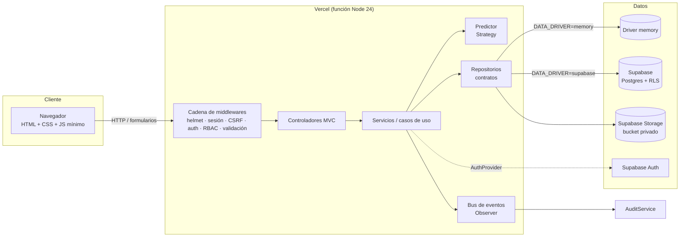
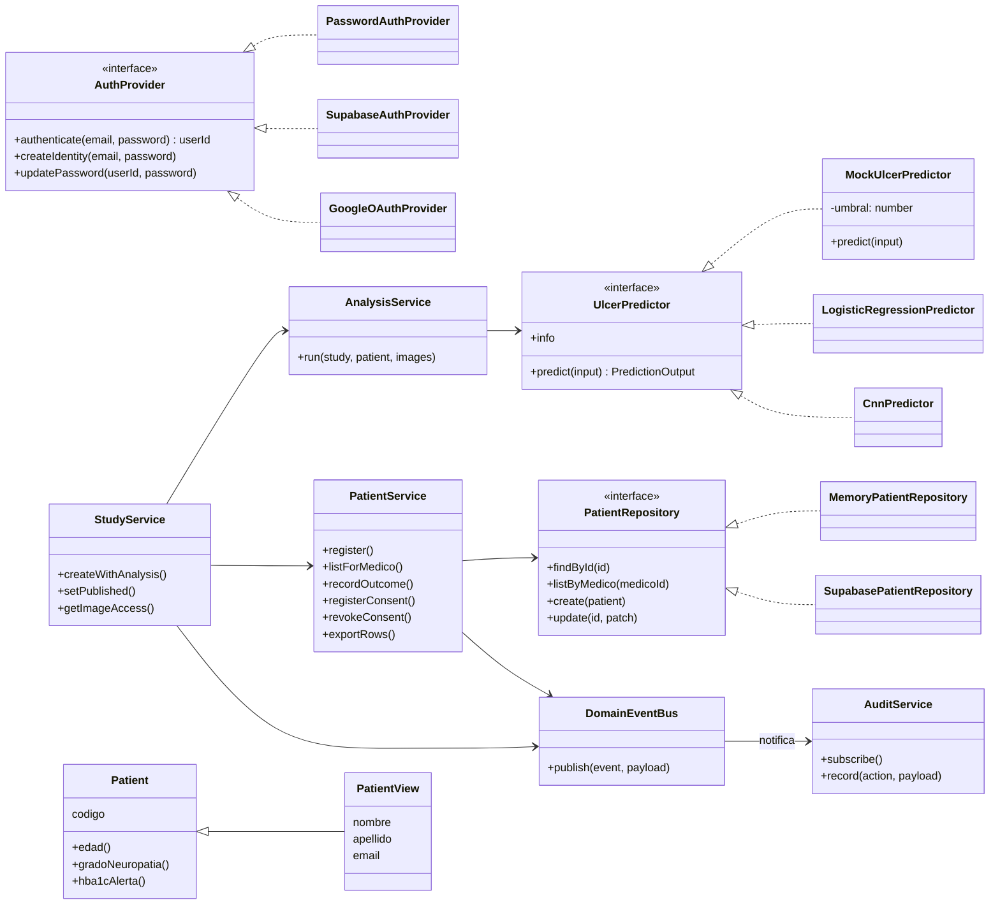
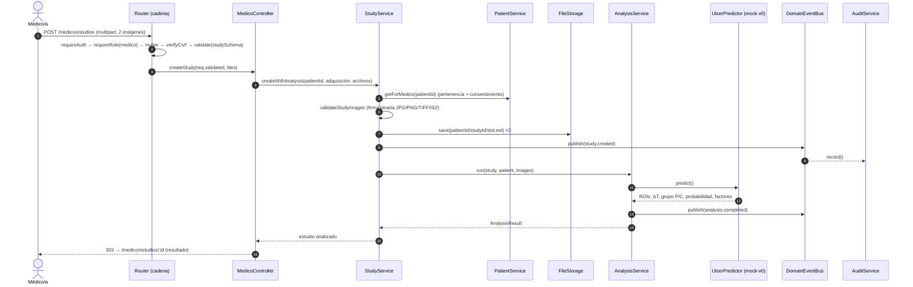
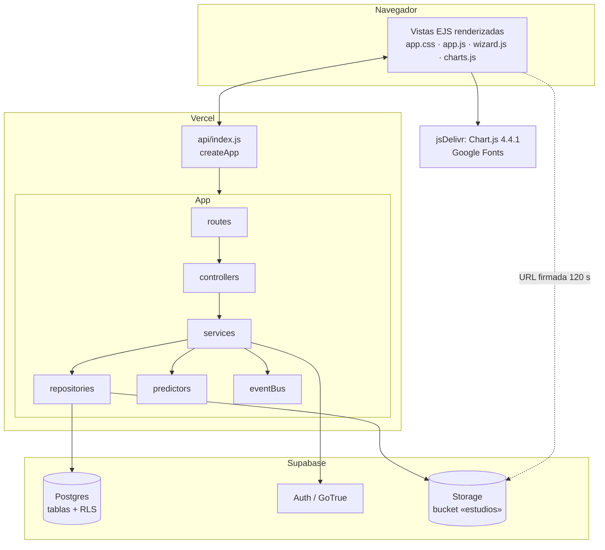

# Arquitectura

Este documento describe la arquitectura del portal TermoPie, las decisiones de diseño y los patrones utilizados, indicando **dónde** se aplica cada uno en el código.

## 1. Vista general

El sistema es una aplicación web monolítica **server-side rendered** (Express 5 + EJS) organizada en capas, desplegable como función serverless en Vercel. La persistencia es intercambiable: en memoria (demostración) o Supabase (Postgres + Auth + Storage).

### Capas

| Capa | Carpeta | Responsabilidad |
| --- | --- | --- |
| Presentación (Vista) | `src/views`, `public/` | Plantillas EJS por rol, sistema de diseño en un único CSS, JS de mejora progresiva. |
| Presentación (Controlador) | `src/controllers`, `src/routes` | Traducir HTTP ↔ casos de uso. Sin reglas de negocio. |
| Middlewares | `src/middlewares` | Seguridad, sesión, autorización, validación, errores, layout. |
| Aplicación (Servicios) | `src/services` | Casos de uso: registrar paciente, crear estudio + análisis, publicar, etc. |
| Dominio | `src/models`, `src/config/domain.js` | Entidades, reglas derivadas (edad, grado de neuropatía, grupo térmico) y constantes del protocolo. |
| Infraestructura | `src/repositories`, `src/config/supabase.js`, `src/services/auth/*Provider.js` | Persistencia, almacenamiento de archivos y proveedores de identidad. |

## 2. Patrones de diseño

| Patrón | Dónde | Para qué |
| --- | --- | --- |
| **MVC** | `controllers/`, `views/`, `models/` | Separar presentación, control y dominio. |
| **Repository** | `repositories/contracts.js` (interfaces), `repositories/memory`, `repositories/supabase` | Aislar a los servicios de la tecnología de persistencia. |
| **Factory** | `repositories/RepositoryFactory.js` (`DATA_DRIVER`), `services/predictors/PredictorFactory.js` (`PREDICTOR`) | Elegir implementaciones concretas por configuración. |
| **Strategy** | `services/predictors/UlcerPredictor.js` → `MockUlcerPredictor`, `LogisticRegressionPredictor`, `CnnPredictor`; `services/auth/AuthProvider.js` → `PasswordAuthProvider`, `SupabaseAuthProvider`, `GoogleOAuthProvider` | Intercambiar el algoritmo de predicción y el mecanismo de autenticación sin tocar los casos de uso. |
| **Singleton** | `config/index.js` (`getConfig`), `config/supabase.js` (`getSupabaseClients`) | Una sola configuración inmutable y un único cliente de base de datos por proceso. |
| **Chain of Responsibility** | `app.js` (cadena global) y `routes/index.js` (`requireAuth → requireRole → multer → verifyCsrf → validate → controlador`) | Cada eslabón decide si corta (redirección, 403, error de validación) o delega. |
| **Observer** | `utils/eventBus.js` (`DomainEventBus`), `services/AuditService.js` | Los servicios publican eventos (`patient.created`, `analysis.completed`, …) y la auditoría se suscribe sin acoplamiento. |
| **DTO / Mapper** | `models/PatientView.js`, `repositories/supabase/mappers.js`, `utils/csv.js` | Combinar ficha clínica + perfil sólo para presentación; mapear camelCase ↔ snake_case; exportar CSV anonimizado. |
| **Service Layer** | `services/*Service.js` | Orquestar casos de uso y reglas (exclusión, consentimiento, pertenencia de objetos). |
| **Inyección de dependencias** | `container.js` (raíz de composición) | Único lugar donde se instancian clases concretas; los tests pueden reemplazar piezas. |

### Principios SOLID aplicados

- **S**: cada servicio cubre un agregado (pacientes, estudios, controles, auditoría).
- **O**: nuevos predictores, proveedores de identidad o suscriptores de eventos se agregan sin modificar los servicios.
- **L**: cualquier implementación de un contrato de repositorio funciona en su lugar (las pruebas e2e ejecutan los mismos flujos con Supabase).
- **I**: contratos pequeños por agregado (`StudyRepository`, `ConsentRepository`, `FileStorage`, …).
- **D**: los servicios dependen de abstracciones inyectadas, nunca de `@supabase/supabase-js` directamente.

## 3. Diagrama de clases (núcleo)

## 4. Diagrama de secuencia: carga de estudio y análisis

## 5. Diagrama de componentes y despliegue

## 6. Seguridad

- **Sesión**: cookie firmada `httpOnly`, `SameSite=Lax`, `Secure` en producción, 8 h; el contenido se reemplaza completo al iniciar sesión (sin fijación de sesión). Apta para serverless (sin almacenamiento de sesión en servidor).
- **CSRF**: token sincronizado por sesión en todos los formularios; para `multipart` se verifica después de `multer`.
- **Cabeceras**: `helmet` con CSP estricta (sin scripts en línea), `frame-ancestors 'none'`, `nosniff`.
- **Fuerza bruta**: `express-rate-limit` en `POST /login`; mensajes de error genéricos y hash constante para usuarios inexistentes (evita enumeración por tiempo).
- **Validación**: Zod en todos los formularios; imágenes validadas por **firma binaria**, no por extensión; tamaño máximo configurable.
- **Autorización**: RBAC por rol + control a nivel de objeto en servicios (un médico sólo ve sus pacientes; un paciente sólo lo suyo; el administrador no ve datos clínicos). En Supabase, además, **RLS** por rol.
- **Archivos**: bucket privado; el servidor entrega URLs firmadas de corta duración tras verificar permisos.
- **Contraseñas**: bcrypt (driver memory) o Supabase Auth; contraseñas temporales con cambio obligatorio en el primer ingreso.
- **Auditoría**: todos los eventos relevantes quedan registrados con actor, entidad, detalle e IP.

## 7. Decisiones y alternativas

| Decisión | Alternativa descartada | Motivo |
| --- | --- | --- |
| SSR con EJS y JS mínimo | SPA (React) | Menor complejidad, mejor accesibilidad base, despliegue serverless simple. |
| Cookie firmada | Sesiones en Redis/DB | Vercel no garantiza estado entre invocaciones. |
| Service-role en servidor + RLS como defensa en profundidad | Cliente con anon key + JWT por usuario | El control fino ya está en los servicios; RLS protege ante una fuga de la anon key o futuros clientes directos. |
| Driver `memory` por defecto | Base de datos obligatoria | Permite demostrar el producto sin infraestructura. |
| Ficha clínica seudonimizada (`codigo`) separada del perfil | Una sola tabla de pacientes | Minimización de datos (Ley 25.326) y exportaciones anonimizadas. |
