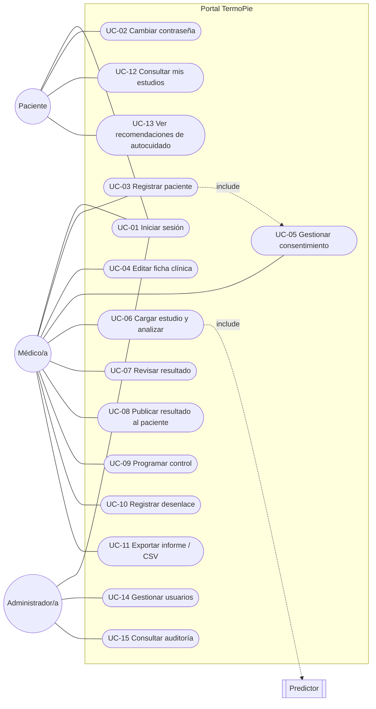

# Casos de uso

## Actores

| Actor | Descripción |
| --- | --- |
| **Médico/a** | Profesional del centro participante. Registra pacientes, carga tomas termográficas, interpreta resultados y registra el desenlace. |
| **Paciente** | Persona adulta con DM1/DM2 incorporada al protocolo. Consulta sus estudios, resultados publicados y recomendaciones. |
| **Administrador/a** | Gestiona cuentas y supervisa la auditoría. No accede a datos clínicos. |
| **Predictor** (sistema) | Estrategia de análisis (`mock-v0` hoy; regresión logística / CNN en el futuro). |
| **Supabase** (sistema) | Autenticación, base de datos y almacenamiento de imágenes. |

## Diagrama

## Especificación resumida

| ID | Caso de uso | Actor | Precondición | Flujo principal | Alternativas / reglas |
| --- | --- | --- | --- | --- | --- |
| UC-01 | Iniciar sesión | Todos | Cuenta activa | Ingresa correo y contraseña → el sistema lo dirige al inicio de su rol. | Credenciales inválidas: mensaje genérico. Más de 10 intentos en 15 min: bloqueo temporal. Cuenta desactivada: acceso denegado. |
| UC-02 | Cambiar contraseña | Todos | Sesión iniciada | Ingresa la actual y la nueva (≥8, mayúscula, minúscula, número). | Con contraseña temporal, el sistema obliga a cambiarla antes de navegar. |
| UC-03 | Registrar paciente | Médico/a | — | Verifica criterios de exclusión, completa identificación (correo Gmail), datos clínicos y consentimiento → se crea la cuenta y se muestra la contraseña temporal una única vez. | Criterio de exclusión marcado: no se permite el alta. Código o DNI duplicado: error. |
| UC-04 | Editar ficha clínica | Médico/a | Paciente propio | Modifica datos clínicos y de contacto. | Código y correo no editables. |
| UC-05 | Gestionar consentimiento | Médico/a | Paciente propio | Registra firma (versión vigente) o revocación con motivo. | Sin consentimiento vigente no se pueden cargar estudios. |
| UC-06 | Cargar estudio comparativo y analizar | Médico/a | Paciente propio con consentimiento | Asistente de 4 pasos: paciente y fechas de las tomas → condiciones ambientales y checklist → **termografía de la toma 1 (basal) y de la toma 2 (control ~30 días después)** → análisis comparativo. | La toma 1 puede reutilizarse de un estudio anterior del mismo paciente. Condiciones fuera de rango: advertencia (no bloquea). Imagen no válida: motivo obligatorio. Archivo inválido: se rechaza por firma binaria. Los IS2 se previsualizan en el servidor. |
| UC-07 | Revisar resultado | Médico/a | Estudio analizado | Ve probabilidad, ROIs con temperaturas, ΔT, grupo P/C y umbral usado, simetría, mapa plantar, factores y ficha del modelo. | — |
| UC-08 | Publicar resultado | Médico/a | Estudio analizado | Hace visible el resultado para el paciente (o lo oculta). | — |
| UC-09 | Programar control | Médico/a | Paciente propio | Fecha sugerida a 6 semanas; reemplaza el control pendiente. | Puede marcarse realizado o cancelado. |
| UC-10 | Registrar desenlace | Médico/a | Paciente con estudios | Indica si generó lesión, pie, ROI y fecha. | Si generó lesión, pie y ROI son obligatorios. |
| UC-11 | Exportar | Médico/a | — | Informe imprimible por estudio; CSV anonimizado de todos sus pacientes. | Ambas acciones quedan auditadas. |
| UC-12 | Consultar mis estudios | Paciente | Sesión | Ve la línea de tiempo, imágenes y el resultado en lenguaje simple. | Si no está publicado: «en revisión». |
| UC-13 | Autocuidado | Paciente | Sesión | Lee recomendaciones de cuidado del pie. | — |
| UC-14 | Gestionar usuarios | Administrador/a | — | Alta de médicos, activar/desactivar, restablecer contraseña. | No puede desactivarse a sí mismo. |
| UC-15 | Consultar auditoría | Administrador/a | — | Filtra por acción o texto. | — |

## Historias de usuario y criterios de aceptación

**HU-01 · Registro de paciente por Gmail**
Como médica, quiero registrar a un paciente con su correo de Gmail para que pueda ver sus resultados sin trámites adicionales.
- *Dado* que completo el formulario sin criterios de exclusión y con consentimiento, *cuando* guardo, *entonces* se crea la cuenta con contraseña temporal visible una sola vez y el paciente queda con un código `P.<centro><nnn>`.
- *Dado* que marco un criterio de exclusión, *entonces* el botón de registro se deshabilita y el servidor rechaza el alta.
- *Dado* un correo ya registrado, *entonces* veo un error y no se crea nada.

**HU-02 · Toma termográfica guiada**
Como médico, quiero un asistente que siga el protocolo para no omitir pasos de la captura.
- El asistente muestra 4 pasos y no avanza si faltan datos obligatorios.
- La temperatura (21–24 °C) y la humedad (40–70 %) muestran «Dentro del protocolo» o «Fuera de rango» mientras escribo; la humedad aparece destacada.
- Puedo arrastrar las 2 termografías (toma 1 y toma 2) y veo la vista previa: JPG/PNG en el navegador; IS2 generada por el servidor desde la matriz infrarroja; TIFF como tarjeta de archivo.
- Si el paciente ya tiene una toma 1 cargada, puedo elegirla en lugar de volver a subirla.

**HU-03 · Resultado interpretable**
Como médica, quiero ver qué regiones superan el umbral de asimetría para orientar la inspección clínica.
- La tabla muestra temperatura media derecha e izquierda y ΔT por ROI de cada toma; las filas con |ΔT| ≥ umbral se resaltan.
- La evolución indica en qué regiones aumentó la asimetría entre la toma 1 y la toma 2 (|ΔT₂| − |ΔT₁| ≥ 0,3 °C) y la probabilidad lo tiene en cuenta.
- Veo los mapas plantares de ambas tomas lado a lado o de a uno.
- El resultado indica el umbral usado (1,0 °C por defecto) y la referencia bibliográfica (2,2 °C).
- Se informa el grupo térmico P/C y la simetría de cada toma.
- El aviso «resultado simulado, no diagnóstico» es siempre visible.

**HU-04 · Resultado para el paciente**
Como paciente, quiero entender mi resultado sin términos técnicos.
- Sólo veo resultados que mi médico publicó.
- Veo un nivel («Riesgo bajo», «Requiere atención», «Seguimiento prioritario») con una explicación simple, sin probabilidades ni métricas del modelo.
- Veo la fecha de mi próximo control y consejos de cuidado.

**HU-05 · Desenlace para validar el modelo**
Como investigadora, quiero registrar si cada paciente generó lesión para validar el modelo con datos reales.
- El tablero indica cuántos pacientes con estudios no tienen desenlace registrado.
- El CSV exportado incluye la columna `GENERÓ LESIÓN` junto a las mediciones por ROI.

**HU-06 · Privacidad**
Como paciente, quiero que mis datos clínicos no estén asociados a mi nombre fuera de la atención.
- La ficha clínica se identifica por código; el CSV no contiene nombre, correo ni DNI.
- El administrador no puede ver fichas ni imágenes.
- Puedo ver mi consentimiento y mis derechos (acceso, rectificación, supresión, revocación).

**HU-07 · Trazabilidad**
Como administrador, quiero auditar quién hizo qué y cuándo.
- Cada alta, análisis, publicación, exportación, cambio de contraseña e intento de ingreso queda registrado con usuario, fecha e IP.
