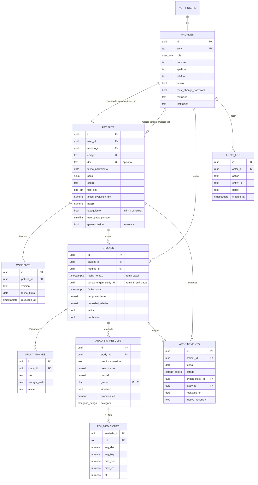

# Modelo de datos

El esquema está en [`supabase/migrations`](../supabase/migrations). El driver `memory` usa las mismas entidades (`src/models`).

**Principio rector**: la ficha clínica (`patients`) se identifica sólo por el **código anónimo** (`P.<centro><nnn>`, p. ej. `P.HC901`; los pacientes demo usan `DEMO-001` … `DEMO-012`). Los datos personales identificatorios necesarios para el acceso (nombre, correo, teléfono) están en `profiles`, vinculados por `user_id`. El DNI es opcional y nunca se muestra en listados ni exportaciones.

## Diagrama entidad-relación

## Diccionario de datos

### Tipos enumerados

| Tipo | Valores |
| --- | --- |
| `user_role` | `admin`, `medico`, `paciente` |
| `sexo` | `F`, `M` |
| `tipo_dm` | `I`, `II` |
| `pie` | `derecho`, `izquierdo`, `ambos` |
| `roi` | `dedo_mayor`, `dedos_menores`, `metatarso`, `arco_interno`, `arco_externo`, `talon`, `general` |
| `categoria_riesgo` | `sin_riesgo` (<50 %), `moderado` (50–69,9 %), `alto` (≥70 %) |
| `estado_estudio` | `borrador`, `analizado` |
| `estado_control` | `pendiente`, `realizado`, `ausente`, `cancelado`, `reprogramado` |

### `profiles` (datos de acceso e identificación)

| Columna | Tipo | Descripción |
| --- | --- | --- |
| `id` | uuid PK → `auth.users` | Identidad de Supabase Auth. |
| `email` | text único, minúsculas | Usuario de ingreso (Gmail del paciente). |
| `role` | `user_role` | Rol RBAC. |
| `nombre`, `apellido`, `telefono` | text | Datos personales. |
| `activo` | bool | Cuenta habilitada. |
| `must_change_password` | bool | Obliga a cambiar la contraseña temporal. |
| `matricula`, `especialidad`, `institucion` | text | Datos profesionales (médicos). |
| `last_login_at` | timestamptz | Último ingreso. |

### `patients` (ficha clínica seudonimizada)

| Columna | Tipo | Descripción / regla |
| --- | --- | --- |
| `codigo` | text único `^P\.[A-Z]{2,4}\d{3}$` | Código anónimo; prefijo según centro (HC, RF, VHF, HNC). |
| `dni` | text opcional `^\d{7,8}$` | No se lista ni exporta. |
| `fecha_nacimiento` | date | Edad derivada. |
| `centro` | text | Hospital Córdoba, Hospital Ferreyra, Clínica Reina Fabiola, Hospital de Clínicas. |
| `tipo_dm` | `tipo_dm` | DM1 / DM2. |
| `anios_evolucion_dm` | numeric(4,1) | Años de preexistencia (decimal). |
| `insulinorequiriente` | bool | |
| `hba1c` | numeric(3,1) | %, 1 decimal. |
| `hba1c_fecha`, `hba1c_imputada`, `hba1c_nota` | date, bool, text | Alerta si >12 meses o imputada; nota libre («pedir nuevos estudios»). |
| `tabaquismo` | bool **nullable** | `null` = «a consultar». |
| `neuropatia`, `neuropatia_puntaje` | bool, smallint 0–10 | Grado derivado: Normal 0, Leve 1–2, Moderada 3–5, Grave 6–10. |
| `vibratoria_der/izq` | numeric 0–50 | µV; ≤30 conservada, >30 alterada. |
| `vibratoria_der/izq_mas50` | bool | Opción «>50». |
| `ulcera_previa_der/izq`, `isquemia`, `ampollas`, `hiperqueratosis`, `eritema`, `hematomas` | bool | Antecedentes e inspección. |
| `hiperqueratosis_localizacion`, `observaciones` | text | |
| `indice_tobillo_brazo`, `peso_kg`, `cirugias_previas`, `patologias_previas` | | Campos previstos para etapas futuras. |
| `exclusion` | jsonb | Checklist de exclusión al alta (muletas/prótesis, deterioro cognitivo, artritis/Charcot/trauma, no camina 100 m, úlceras activas, >150 kg). |
| `consentimiento_firmado`, `consentimiento_fecha` | bool, date | Estado vigente (el historial está en `consents`). |
| `genero_lesion` | bool **nullable** | Desenlace del seguimiento (`null` = sin registrar). |
| `lesion_fecha`, `lesion_pie`, `lesion_roi`, `lesion_notas` | | Obligatorios pie y ROI si `genero_lesion = true` (check). |

### `consents`

Historial de firmas y revocaciones (`version`, `fecha_firma`, `registrado_por`, `revocado_at`, `motivo_revocacion`).

### `studies` (estudio comparativo toma 1 / toma 2)

| Columna | Tipo | Descripción / regla |
| --- | --- | --- |
| `fecha_hora` | timestamptz | Fecha de la **toma 2** (control, visita actual). |
| `fecha_toma1` | timestamptz | Fecha de la **toma 1** (basal); debe ser anterior a la toma 2. |
| `toma1_origen_study_id` | uuid → `studies` | Si la toma 1 se reutilizó de un estudio anterior. |
| `temp_ambiente_toma1`, `humedad_relativa_toma1` | numeric | Condiciones de la toma 1 (opcionales). |
| `centro` | text | |
| `temp_ambiente` | numeric(4,1) | Válido 21–24 °C (badge verde/ámbar). |
| `humedad_relativa` | numeric(4,1) | Válido 40–70 %. Factor ambiental más influyente: se resalta. |
| `distancia_cm`, `emisividad`, `rango_min/max`, `paleta`, `tiempo_estabilizacion_min` | | 80 cm, 0,98, 24–35 °C, Ironbow, 15 min por defecto. |
| `fondo` | text | `Cartulina` o `Tela`. |
| `valida`, `motivo_invalidez` | bool, text | Si no es válida, el motivo es obligatorio. |
| `checklist` | text[] | Ítems confirmados de la captura. |
| `notas_medico`, `publicado`, `publicado_at` | | Visibilidad del resultado para el paciente. |

### `study_images`

Una fila por imagen (`slot` = `toma1` / `toma2`, ambas termografías), con `storage_path` (bucket `estudios`, ruta `<patient_id>/<study_id>/<slot>.<ext>`) o `public_url` (sólo imágenes demo), `mime`, `size_bytes`, `original_name`.

### `analysis_results` y `roi_mediciones`

`analysis_results` guarda la salida del predictor: versión, origen de las temperaturas (`fuente_rois`: `imagen`, `is2` o `simulada`), **umbral usado**, ΔT máximo, ROI, grupo térmico `P`/`C` (P = alguna ROI con |ΔT| ≥ umbral) y `simetrico` (|ΔT general| < 1 °C) **de la toma 2 y de la toma 1** (`*_toma1`), probabilidad (considera la evolución), categoría, horizonte (6 semanas) y factores (jsonb). `roi_mediciones` guarda, **por toma** (`toma` 1 o 2), las temperaturas absolutas por ROI (`avg_der`, `avg_izq`, `max_*`, `min_*`) y `dt` = der − izq. La variación de la asimetría (|ΔT₂| − |ΔT₁|) se calcula en la entidad `AnalysisResult`.

### `appointments`, `audit_log`

Controles de seguimiento (un control nuevo reprograma el pendiente) y registro de auditoría (actor, acción, entidad, detalle, IP, fecha). En `appointments`, `origen_study_id` es el estudio que originó el control, `study_id` el estudio realizado en ese control (toma 2), `realizado_en` la fecha efectiva y `motivo_ausencia` el motivo cuando el estado es `ausente` (migración `20260601000400_controles.sql`). Un control pendiente se considera **vencido** al terminar el día programado.

## Exportación CSV

`GET /medico/pacientes/exportar.csv` genera una fila por estudio analizado con las columnas de la planilla del equipo: `ID PACIENTE, EDAD, SEXO, AÑOS DE PREEXISTENCIA DE DIABETES, TIPO DE DIABETES, INSULINO REQUIRIENTE, HbA1c, TABAQUISMO, NEUROPATIA, GRADO DE NEUROPATÍA, VIBRATORIA PIE DERECHO/IZQUIERDO, ANTECEDENTES DE ULCERAS PIE DERECHO/IZQUIERDO, ISQUEMIA, AMPOLLAS, HIPERQUERATOSIS, ERITEMAS, HEMATOMAS, GENERÓ LESIÓN`; luego, **para cada toma** (prefijos `T1` y `T2`), `AVG DER / AVG IZQ / DIF REG` por ROI, `GRUPO (P/C)` y `SIMETRICO`; después la `VARIACION |DIF|` por ROI (|ΔT₂| − |ΔT₁|) y, al final, columnas propias del portal (`FECHA TOMA 1`, `FECHA TOMA 2`, `DIAS ENTRE TOMAS`, `UMBRAL ΔT`, `PROBABILIDAD (%) SIMULADA`). Separador `;`, coma decimal y BOM UTF-8 para Excel es-AR. No incluye nombre, correo ni DNI.
